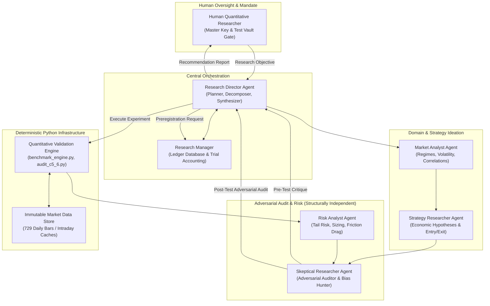
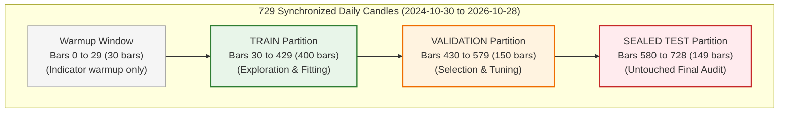
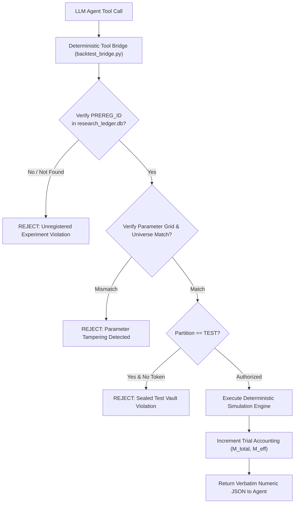

# Autonomous Quant Research Agent: Architectural Specification and Proposal

**Date:** 2026-10-30  
**Repository:** `E:\projects\binance`  
**Current Status:** Direction C.5.6 Release Gate Complete (`ACCEPT FOR OFFLINE EXPLORATORY COMPARATIVE RESEARCH WITH DOCUMENTED LIMITATIONS`, 517 passing unit tests)  
**Safety & Execution Constraints:** Strictly Offline; All Broker/Exchange Execution Paths Disabled; Strategy V5 Frozen as `VERIFIED NO-GO`; Zero V6 Development; Zero Em Dashes.

---

## 1. Product Vision and Core Philosophy

The objective of this system is to build an intelligent, autonomous quantitative research agent for Binance cryptocurrency markets. 

The system is **NOT** a trading bot, a signal generator, or an automated execution script. It is an autonomous scientific research system designed to independently formulate trading hypotheses, design rigorous empirical experiments, stress-test candidate strategies, adversarially critique its own findings, and evaluate whether genuine, economically viable alpha exists.

### Ten Invariant Research Principles

1. **Evidence over opinions:** Backtest curves and narrative arguments have zero evidential weight without out-of-sample verification and statistical testing.
2. **Reproducibility over convenience:** Every experiment must be 100% bit-exact reproducible from logged random seeds, immutable data partitions, and frozen code hashes.
3. **Rejection is a positive research outcome:** The primary purpose of research is to prune false discoveries quickly and inexpensively. Disproving a flawed hypothesis preserves capital and prevents curve-fitting.
4. **Deterministic quantitative sovereignty:** No LLM agent is permitted to compute, adjust, or override numerical calculations. All backtests, risk numbers, benchmark comparisons, and statistical p-values originate strictly from audited Python engines.
5. **Multiple-testing discipline:** Every evaluated variation, filter, or parameter grid increments the global project trial counter ($M_{\text{total}}$). Deflated Sharpe Ratios (DSR) and Family-Wise Error Rate (FWER) adjustments are mandatory, complemented by effective independent trial accounting ($M_{\text{eff}}$).
6. **No in-sample approvals:** In-sample performance is solely for parameter discovery. Hypotheses are accepted or rejected exclusively on untouched out-of-sample data.
7. **Zero look-ahead and data leakage:** Data scaling, indicator warmup, regime classification, and rebalancing signals must strictly use information available at Day $t$ Close for execution at Day $t+1$ Open.
8. **Preregistration enforced at tool boundary:** Hypotheses, parameter grids, universe selections, cost assumptions, and validation gates must be written to an immutable ledger before testing begins. The execution engine rejects any request lacking an approved preregistration ID.
9. **No arbitrary parameter optimization:** Parameter sweeps without prior economic theory are classified as data mining and penalized accordingly.
10. **Human-in-the-loop governance:** The autonomous agent produces recommendations (`GO`, `NO-GO`, `INCONCLUSIVE`). It never authorizes production deployment, live capital, or execution pathways without human approval.

---

## 2. Specialized Agent Architecture and Permission Boundaries

The research framework is structured as a collaborative, multi-agent committee where specialized personas interact with a deterministic Python engine. Full permission rules are governed by `trader/agent_permission_matrix.md`.



### 2.1 Persona Specifications and Cognitive Firewalls

#### A. Research Director (Central Orchestrator)
- **Role:** Chief scientist and workflow manager.
- **Responsibilities:** Decomposes research objectives into testable hypotheses, coordinates agents, tracks state, and synthesizes evidence into formal recommendations.
- **Restrictions:** Cannot write strategy code; cannot alter quantitative engine outputs.

#### B. Market Analyst (Domain & Macro Characterization)
- **Role:** Empirical market regime specialist.
- **Responsibilities:** Diagnoses historical volatility, trend slope, and cross-asset correlation structure across BTC, ETH, SOL, and BNB.
- **Restrictions:** Read-only access to historical indicators; cannot propose trading signals.

#### C. Strategy Researcher (Hypothesis Architect)
- **Role:** Quantitative trading hypothesis generator.
- **Responsibilities:** Formulates falsifiable hypotheses grounded in structural economic mechanisms (risk premia, behavioral under-reaction, capital constraints). Proposes entry/exit rules and parameter ranges.
- **Requirements:** Every hypothesis must answer: "Why should this edge exist and who pays for it?"

#### D. Skeptical Researcher (Adversarial Auditor)
- **Role:** Structural adversary and bias hunter.
- **Cognitive Firewall:** Operates completely independently from the Strategy Researcher with zero shared conversational context. It receives only the frozen preregistration and verbatim JSON backtest outputs.
- **Responsibilities:** Actively seeks look-ahead bias, data leakage, curve-fitting, parameter cliffs, regime dependencies, and friction underestimation. Recommending strategy rejection is a primary successful outcome.

#### E. Risk Analyst (Downside & Economic Viability Specialist)
- **Role:** Portfolio risk and friction evaluator.
- **Responsibilities:** Evaluates drawdowns, Sortino ratios, tail risk (VaR/CVaR), taker fee drag ($0.10\%$ Spot / $0.05\%$ Futures), slippage drag ($0.05\%$ per leg), and cash drag.

#### F. Quantitative Validation Engine (Deterministic Python Core)
- **Role:** Mathematical source of truth.
- **Responsibilities:** Pure Python/Numba execution (`benchmark_engine.py`, `audit_direction_c5_6.py`). Executes backtests, paired bootstrap tests, DSR calculations, and dependence pre-screening. **LLMs never compute numbers.**

#### G. Research Manager (Institutional Memory & Trial Accounting)
- **Role:** Experiment ledger guardian and registrar.
- **Responsibilities:** Manages the SQLite research ledger (`research_ledger.db`). Enforces tool-boundary preregistration, manages the sealed test vault, and maintains append-only global trial accounting.

---

## 3. Data Architecture and Sealed Test Partition Protocol

To prevent test-set overfitting, data access is strictly governed by `trader/test_partition_protocol.md`.



### 3.1 Sealed Vault Architecture
- **TRAIN (Bars 30 to 429):** Open for exploratory analysis and model discovery.
- **VALIDATION (Bars 430 to 579):** Accessible strictly through preregistered queries for hyperparameter selection and block-length sensitivity ($L \in \{5, 10, 20\}$).
- **TEST (Bars 580 to 728):** Sealed behind an architectural vault gate.
  - The agent tool bridge rejects all requests to evaluate the test partition unless authorized by a single-use `TEST_EVALUATION_TOKEN` signed by human authorization.
  - Test evaluations are logged permanently. Repeated test queries accumulate a severe statistical penalty via the Harvey-Liu Haircut Sharpe Ratio and Holm-Bonferroni step-down adjustment. The system never claims a test partition remains untouched after repeated queries.

### 3.2 Look-Ahead and Data Leakage Prevention
- **Execution Timing:** Signals calculated at Day $t$ Close execute at Day $t+1$ Open.
- **Point-in-Time Indicators:** Indicator calculations strictly use expanding or rolling past windows. Full-sample normalization or z-scoring is prohibited.
- **Dataset Limitations:** The framework explicitly recognizes that 729 daily bars ($N=729$ total, $N=149$ test) captures one market cycle and provides limited standalone test bootstrap power. The 4-coin universe also exhibits survivorship bias, requiring future expansion to point-in-time universe snapshots.

---

## 4. Controlled Tool Interfaces: Enforcing Preregistration at the Boundary

LLMs cannot run ad-hoc backtests or alter simulation parameters. Every backtest must reference an approved `preregistration_id`.



### 4.1 Pydantic Tool Schemas

```python
class PreregisterExperimentInput(BaseModel):
    hypothesis_id: str = Field(description="Unique identifier for hypothesis, e.g. H-SYN-1")
    strategy_name: str = Field(description="Strategy family name")
    economic_rationale: str = Field(description="Structural economic mechanism explaining expected edge")
    universe: list[str] = Field(description="Asset universe, e.g. ['BTCUSDT']")
    timeframe: str = Field(description="Timeframe interval, e.g. '1d'")
    parameter_grid: dict[str, list[float]] = Field(description="Exact parameter values to test")
    cost_model: dict[str, float] = Field(description="Taker fee and slippage rates")
    benchmark_ids: list[str] = Field(description="Reference benchmarks from catalog")

class RunBacktestInput(BaseModel):
    preregistration_id: str = Field(description="Preregistration ID from research ledger")
    config_params: dict[str, float] = Field(description="Specific parameters matching registered grid")
    partition: Literal["TRAIN", "VALIDATION", "TEST"] = Field(description="Data split to evaluate")
    test_token: str | None = Field(default=None, description="Required only when partition is TEST")
```

---

## 5. Global Trial Accounting and Effective Independent Degrees of Freedom

The trial accounting system in `research_ledger.db` maintains an append-only registry tracking every strategy hypothesis, parameter combination, rejected pre-test idea, failed run, and test query.

### 5.1 Multiple-Testing Correction Mathematics
A naive counter ($M = M + 1$) assumes all tested strategies are independent. In practice, parameter variations (e.g. 20-day vs 21-day lookback) share $> 95\%$ return correlation.

The system tracks:
1. **Raw Cumulative Trials ($M_{\text{total}}$):** Upper-bound conservative trial count.
2. **Effective Independent Trials ($M_{\text{eff}}$):** Calculated from the eigenvalues $\lambda_i$ of the trial return correlation matrix $\Sigma_M$:
   $$M_{\text{eff}} = \frac{\left(\sum_{i=1}^{M} \lambda_i\right)^2}{\sum_{i=1}^{M} \lambda_i^2} \le M_{\text{total}}$$
3. **Deflated Sharpe Ratio (DSR):** `calc_deflated_sharpe_ratio` in `benchmark_engine.py` evaluates expected maximum Sharpe under selection bias across both $M_{\text{total}}$ and $M_{\text{eff}}$, presenting both to the Skeptical Researcher.

---

## 6. Minimal Strategy Interface and Synthetic Demonstration Strategy

In strict adherence to project constraints, **no existing strategy files (V1, V3, V4, V5) will be refactored or modified in Phase 1.** V5 remains permanently frozen as `VERIFIED NO-GO`. No V6 will be created.

### 6.1 Minimal Strategy Protocol
```python
class StrategyInterface(ABC):
    @abstractmethod
    def compute_indicators(self, data: pd.DataFrame) -> pd.DataFrame:
        """Point-in-time indicator calculation strictly on historical bars."""
        ...

    @abstractmethod
    def generate_signals(self, data: pd.DataFrame, params: dict[str, float]) -> pd.Series:
        """Generate target position signals (-1, 0, +1) at bar Close."""
        ...
```

### 6.2 Synthetic Demonstration Strategy (`SyntheticSMAStrategy`)
A minimal, transparent moving-average crossover strategy (`fast_period`, `slow_period`) will serve as the initial test vehicle to verify data loading, partition boundaries, tool-bridge execution, and benchmark engine integration without touching legacy strategy code.

---

## 7. Technology Evaluation and LLM Provider Selection

### 7.1 Orchestration Framework
- **Decision:** Native Typed StateGraph implemented with `pydantic 2.12.5` and standard library `sqlite3`.
- **Rationale:** Avoids pulling 19 transitive dependencies from LangGraph into Python 3.14.0 while achieving 100% deterministic, inspectable state transitions.

### 7.2 Configuration-Based LLM Provider Integration
To prevent vendor lock-in and assess whether persona specialization improves research quality, the system routes through a provider-agnostic `LLMClient` configured via `config.yaml`:

```yaml
llm:
  default_provider: "anthropic"
  default_model: "claude-3-7-sonnet"
  providers:
    anthropic:
      model: "claude-3-7-sonnet"
    openai:
      model: "gpt-4o"
    deepseek:
      model: "deepseek-r1"
    local_ollama:
      model: "llama3.3:70b"
      base_url: "http://localhost:11434"
  persona_assignments:
    research_director: "default"
    market_analyst: "default"
    strategy_researcher: "default"
    skeptical_researcher: "deepseek"  # Deep reasoning for adversarial audit
    risk_analyst: "default"
```
The architecture evaluates models on reasoning depth, tool-calling schema adherence, and cost, permitting local air-gapped execution via Ollama.

---

## 8. Minimal End-to-End Prototype Workflow

The initial implementation targets a single vertical slice:
1. **User Objective:** "Evaluate a 10/30 SMA trend filter on BTCUSDT."
2. **Hypothesis Creation:** Research Director creates structured Hypothesis `H-SYN-1`.
3. **Adversarial Critique:** Skeptical Researcher highlights whipsaw risk in sideways regimes.
4. **Preregistration:** Research Manager freezes parameters and cost model in SQLite ledger.
5. **Deterministic Simulation:** Python engine runs `SyntheticSMAStrategy` on TRAIN partition.
6. **Risk Evaluation:** Risk Analyst assesses drawdown and transaction fee drag.
7. **Recommendation:** Research Director issues an evidence-backed `INCONCLUSIVE` or `NO-GO` recommendation.
8. **Dossier Archival:** Research Manager commits complete record to `research_ledger.db`.

---

## 9. Next Steps and Implementation Authorization

The revised architecture addresses all eight core review points. In strict accordance with instructions, implementation code will not be written until formal approval of `trader/agent_implementation_plan.md`.
