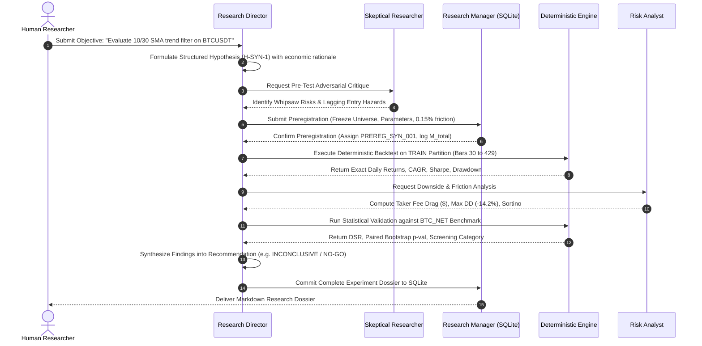

# Phased Implementation Plan & Minimal Prototype Specification

**Date:** 2026-10-30  
**Repository:** `E:\projects\binance`  
**Status:** Implementation Roadmap (Pending User Approval)  
**Safety & Execution Constraints:** Strictly Offline; All Broker/Exchange Execution Paths Disabled; Strategy V5 Frozen as `VERIFIED NO-GO`; Zero V6 Development; Zero Em Dashes.

---

## 1. Implementation Philosophy and Guardrails

To build a reliable, evidence-first quantitative research agent without introducing regressions or destabilizing working infrastructure, this implementation plan adheres to four defensive rules:

1. **Zero Premature Refactoring:** Legacy strategy modules (`research_v3_mean_reversion.py`, `research_v4_relative_strength.py`, `research_v5_trend_following.py`, `experiments.py`) will **not** be modified or refactored. They remain preserved as historical research baselines.
2. **Synthetic Demonstration First:** The initial framework proof will use a minimal `SyntheticSMAStrategy` to prove end-to-end compatibility with `benchmark_engine.py` and the data layer without touching existing strategies.
3. **Regression Safety Gate:** The existing 517 unit tests must run and pass before and after every phase.
4. **Tool-Enforced Preregistration:** No backtest can execute without a registered, verified `PREREG_ID` in `research_ledger.db`.

---

## 2. Minimal End-to-End Prototype (Vertical Slice)

Before building the complete multi-agent system, we will implement and verify a single vertical slice proving the entire scientific research loop.



### Prototype Workflow Steps
1. **Objective Intake:** User submits an objective: "Evaluate whether a 10/30 moving-average cross on daily BTCUSDT generates risk-adjusted excess returns after fees."
2. **Structured Hypothesis Generation:** Research Director formalizes Hypothesis `H-SYN-1` with explicit entry/exit rules, parameter bounds, and an economic thesis.
3. **Pre-Test Adversarial Critique:** Skeptical Researcher reviews the hypothesis and flags risks (e.g. range-bound whipsaw costs, transaction drag).
4. **Enforced Preregistration:** Research Manager records the parameters, cost model ($0.10\%$ fee, $0.05\%$ slippage), and universe to `research_ledger.db`, issuing `PREREG_SYN_001` and incrementing trial accounting.
5. **Deterministic Execution:** The deterministic engine loads immutable train-partition candles (`[30:430]`), executes `SyntheticSMAStrategy`, and calculates equity curves and daily returns.
6. **Risk & Friction Evaluation:** Risk Analyst computes true transaction fee drag, Sortino ratio, and max drawdown.
7. **Statistical Testing:** Quantitative engine executes `paired_block_bootstrap_test` and `calc_deflated_sharpe_ratio` against the `BTC_NET` benchmark catalog.
8. **Dossier Archival:** Research Director outputs a structured recommendation dossier, and Research Manager commits all metrics and audit logs to the SQLite database.

---

## 3. Exact Files to Be Created in Phase 1

All new files will be created in a clean, self-contained subpackage under `trader/agent/` and a corresponding test suite under `tests/`. **Zero existing files outside `trader/` will be modified.**

```
E:\projects\binance\
├── tests\
│   └── test_agent_prototype.py       # Comprehensive unit tests for prototype (new)
└── trader\
    ├── research_ledger.db            # SQLite relational experiment store (new)
    └── agent\                        # Target agent package (new)
        ├── __init__.py
        ├── core\
        │   ├── __init__.py
        │   ├── strategy_base.py      # Abstract StrategyInterface protocol
        │   └── synthetic_strategy.py # Minimal SyntheticSMAStrategy demonstration
        ├── db\
        │   ├── __init__.py
        │   ├── schema.py             # SQLite schema (hypotheses, preregistrations, trials)
        │   └── ledger.py             # Append-only transaction manager & trial accounting
        ├── tools\
        │   ├── __init__.py
        │   ├── market_bridge.py      # Read-only candle provider with sealed test wall
        │   ├── backtest_bridge.py    # Deterministic simulation caller with prereg verification
        │   └── statistical_bridge.py # Bridge to benchmark_engine.py (DSR, bootstrap, screening)
        └── personas\
            ├── __init__.py
            ├── director.py           # Research Director persona
            ├── skeptic.py            # Skeptical Researcher persona
            └── risk.py               # Risk Analyst persona
```

---

## 4. Protection of Existing Statistical and Test Assets

To guarantee that Directions C.1 through C.5.6 remain fully intact:
1. **Verbatim Math Reuse:** The new tool bridges (`statistical_bridge.py` and `backtest_bridge.py`) import functions directly from `trader-timemachine/benchmark_engine.py` and `trader-timemachine/audit_direction_c5_6.py`. No mathematical formulas will be re-implemented.
2. **Existing 517 Tests as Regression Baseline:** The complete suite (`python -m unittest discover tests -p "test_*.py"`) will run prior to merging any new component.
3. **Isolated Test Suite:** New agent prototype tests will be housed exclusively in `tests/test_agent_prototype.py`.
4. **Repository Invariants:** `tests/test_repo.py` will run continuously to verify zero em dashes (`\u2014`) and preserve root directory structure.

---

## 5. Global Trial Accounting and Multiple-Testing Mathematics

A simple counter ($M = M + 1$) fails to capture the true statistical penalty of multiple testing because financial strategies often share high cross-correlation. The trial accounting engine implements a two-tier framework:

### Tier 1: Append-Only Trial Ledger
The database records every ideated, tested, or rejected iteration:
- `trial_id`: Sequential UUID.
- `hypothesis_id`: Associated research hypothesis.
- `parameters_evaluated`: Parameter dictionary.
- `disposition`: `REJECTED_PRE_TEST`, `FAILED_VALIDATION`, `EVALUATED_TRAIN`, `TEST_EVALUATED`, `DUPLICATE_DISCARDED`.
- `cumulative_raw_m`: Running total of all evaluations.

### Tier 2: Effective Degrees of Freedom ($M_{\text{eff}}$)
Following Bailey & López de Prado (2014) and Harvey & Liu (2015), the effective number of independent trials $M_{\text{eff}}$ accounts for correlation across candidate return series:
$$M_{\text{eff}} = \frac{(\sum_{i=1}^{M} \lambda_i)^2}{\sum_{i=1}^{M} \lambda_i^2} \le M_{\text{total}}$$
where $\lambda_i$ are the eigenvalues of the trial return correlation matrix $\Sigma_M$.
- When strategies are identical or highly collinear ($\rho \approx 1.0$), $M_{\text{eff}} \approx 1$.
- When strategies are completely orthogonal ($\rho \approx 0.0$), $M_{\text{eff}} = M_{\text{total}}$.
- The Deflated Sharpe Ratio calculation in `benchmark_engine.py` will accept both $M_{\text{total}}$ (conservative upper bound) and $M_{\text{eff}}$ (eigenvalue-adjusted estimate), presenting both to the Skeptical Researcher.

---

## 6. Detailed Phased Implementation Roadmap

### Phase 1: Prototype Core, Strategy Protocol & Ledger (Weeks 1-2)
- **Deliverables:**
  - `strategy_base.py`: Abstract `StrategyInterface`.
  - `synthetic_strategy.py`: Demonstration SMA crossover.
  - `market_bridge.py`: Data provider with strict partition slicing and sealed test gate.
  - `schema.py` & `ledger.py`: SQLite ledger schema and append-only trial manager.
  - `tests/test_agent_prototype.py`: Verification of partition walls, preregistration enforcement, and benchmark compatibility.
- **Verification Gate:** 517 legacy tests passing + new prototype tests passing.

### Phase 2: Deterministic Tool Bridges & Preregistration Gate (Weeks 3-4)
- **Deliverables:**
  - `backtest_bridge.py`: Rejects any backtest request lacking an approved `PREREG_ID`.
  - `statistical_bridge.py`: Direct bridge to DSR, paired bootstrap, and C.5.6 screening.
  - Verification that LLM cannot fabricate or alter numeric results.
- **Verification Gate:** Mathematical parity tests verifying bit-exact reproduction of C.5.6 results.

### Phase 3: Multi-Provider LLM Clients & Specialized Personas (Weeks 5-6)
- **Deliverables:**
  - `llm_client.py`: Provider-agnostic client supporting OpenAI, Anthropic, Gemini, and local Ollama models.
  - Persona implementations: Research Director, Skeptical Researcher, Risk Analyst.
  - Adversarial test harness: Proving that the Skeptical Researcher successfully rejects intentionally flawed, overfit strategies.
- **Verification Gate:** Blind evaluation tests verifying Skeptic flags look-ahead bias and parameter cliffs.

### Phase 4: State Machine Orchestration & End-to-End Execution (Weeks 7-8)
- **Deliverables:**
  - Orchestrator graph coordinating the 8-step minimal prototype workflow.
  - Automated research dossier markdown generator.
  - Human-in-the-Loop approval gate for sealed test vault access.
- **Verification Gate:** Execution of the vertical slice on Hypothesis `H-SYN-1` yielding a verified research report.

---

## 7. Immediate Action: Stop and Await User Approval

In strict accordance with user instructions, no implementation code has been written. Execution will commence only after formal review and approval of this plan.

