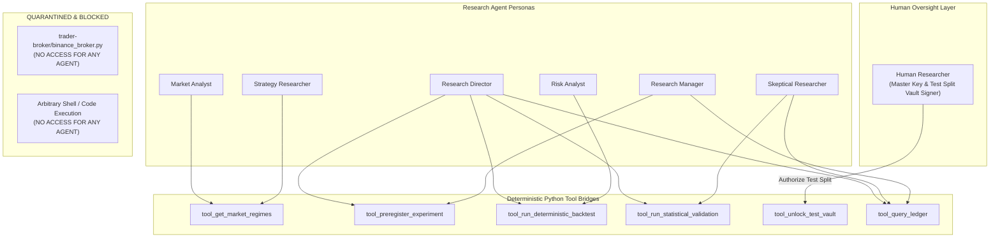
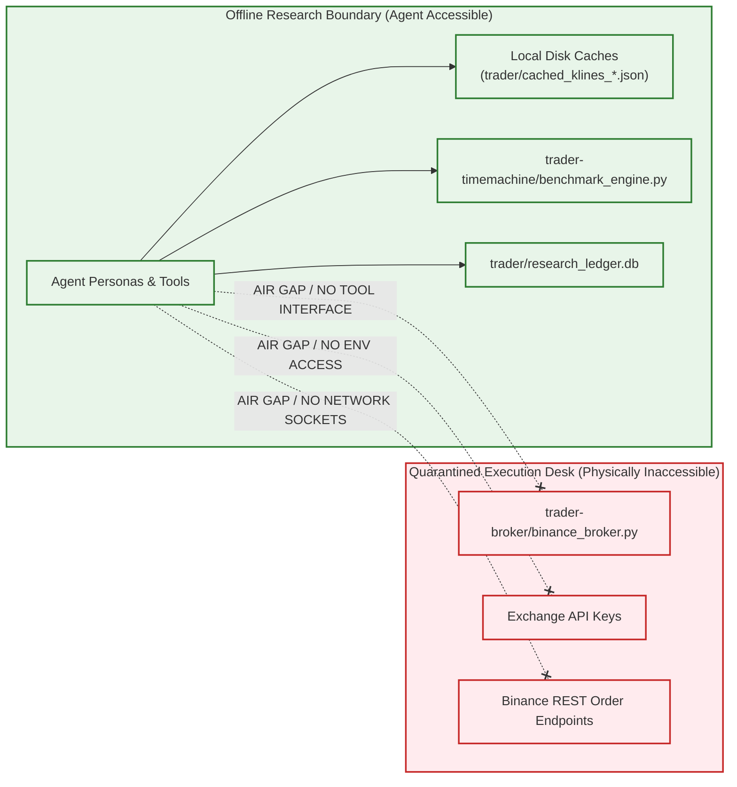

# Agent Permission Matrix & Execution Governance

**Date:** 2026-10-30  
**Repository:** `E:\projects\binance`  
**Status:** Architecture Specification  
**Safety & Execution Constraints:** Strictly Offline; All Broker/Exchange Execution Paths Disabled; Strategy V5 Frozen as `VERIFIED NO-GO`; Zero V6 Development; Zero Em Dashes.

---

## 1. Governance Principles and Architectural Invariants

To guarantee that the autonomous quantitative research agent remains strictly scientific, reproducible, and safe, system permissions are defined by the Principle of Least Privilege:

1. **Zero Arbitrary Execution:** No LLM agent has access to arbitrary Python execution (`eval`, `exec`, dynamic module loading, or interactive shell environments).
2. **Zero Broker Capabilities:** The order execution desk (`trader-broker/binance_broker.py`) and private write endpoints in `binance_client.py` are quarantined. No tool exists in any agent's toolset that can transmit orders to Binance (live, paper, or testnet).
3. **Zero Credential Exposure:** Environment variables containing exchange credentials (`BINANCE_API_KEY`, `BINANCE_API_SECRET`) are explicitly stripped from agent execution contexts.
4. **Statistical Core Immutability:** No agent can modify, patch, or overwrite the mathematical validation formulas in `benchmark_engine.py` or `audit_direction_c5_6.py`.
5. **Append-Only Research Memory:** Completed experiment records, preregistrations, and audit logs are write-once, append-only in `research_ledger.db`. No agent can edit or delete historical records.
6. **Structural Adversarial Independence:** The Skeptical Researcher operates behind a cognitive firewall, completely independent of the Strategy Researcher, with zero shared context other than the frozen preregistration and deterministic backtest output.

---

## 2. Agent Permission Matrix

### 2.1 Permission Matrix Table

| Capability / Resource | Research Director | Market Analyst | Strategy Researcher | Skeptical Researcher | Risk Analyst | Research Manager | Human Researcher |
| :--- | :--- | :--- | :--- | :--- | :--- | :--- | :--- |
| **Read Market Data (Train/Val)** | Yes | Yes | Yes | Yes | Yes | Yes | Yes |
| **Access Sealed Test Partition** | Blocked | Blocked | Blocked | Blocked | Blocked | Blocked | **Master Key Only** |
| **Ideate & Propose Hypotheses** | Yes | Yes | Yes | Blocked | Blocked | Blocked | Yes |
| **Preregister Experiments** | Yes | Blocked | Blocked | Blocked | Blocked | **Enforces & Logs** | Yes |
| **Execute Deterministic Backtest**| Via Tool | Blocked | Blocked | Blocked | Via Tool | Blocked | Direct |
| **Run Statistical Validation** | Via Tool | Blocked | Blocked | Via Tool | Blocked | Blocked | Direct |
| **Issue Pre-Test Critique** | Blocked | Blocked | Blocked | **Mandatory** | Blocked | Blocked | Yes |
| **Issue Post-Test Audit** | Blocked | Blocked | Blocked | **Mandatory** | Review Only | Blocked | Yes |
| **Evaluate Downside & Friction** | Review Only | Blocked | Blocked | Review Only | **Mandatory** | Blocked | Yes |
| **Write/Append to Ledger** | Via Manager | Blocked | Blocked | Via Manager | Via Manager | **Direct ACID** | Direct |
| **Overwrite Completed Trials** | **PROHIBITED**| **PROHIBITED**| **PROHIBITED**| **PROHIBITED**| **PROHIBITED**| **PROHIBITED** | **PROHIBITED** |
| **Arbitrary Code Execution** | **PROHIBITED**| **PROHIBITED**| **PROHIBITED**| **PROHIBITED**| **PROHIBITED**| **PROHIBITED** | Manual CLI |
| **Place Orders / Access Broker**| **PROHIBITED**| **PROHIBITED**| **PROHIBITED**| **PROHIBITED**| **PROHIBITED**| **PROHIBITED** | **PROHIBITED** |

---

## 3. Structural Adversarial Independence Firewall

A primary failure mode of multi-agent LLM systems is "agent collusion," where agents harmonize towards optimistic conclusions to fulfill user prompts.

To prevent confirmation bias, the Skeptical Researcher is structurally quarantined:
1. **Isolated Context Window:** The Skeptical Researcher does not participate in the hypothesis generation conversation. It receives only:
   - The frozen hypothesis statement and economic rationale.
   - The preregistered parameter grid.
   - The verbatim JSON metrics returned by `benchmark_engine.py`.
2. **Asymmetric Objective Function:**
   - Strategy Researcher prompt instructions: "Propose falsifiable hypotheses with structural economic rationale."
   - Skeptical Researcher prompt instructions: "Identify look-ahead bias, data leakage, parameter fragility, regime dependence, and friction underestimation. Recommending strategy rejection is a successful research outcome."
3. **Independent Decision Authority:** If the Skeptical Researcher uncovers material flaws (e.g. parameter sensitivity cliff where $L=10$ passes but $L=5$ and $L=20$ fail, or returns concentrated in a single abnormal week), it issues a formal `AUDIT_FAIL`. A strategy with an `AUDIT_FAIL` cannot receive a `GO` recommendation from the Research Director without human resolution.

---

## 4. Execution Sandbox and Security Boundary

1. **Network Boundary:** The agent environment does not require network access for quantitative backtesting. All calculations run strictly against pre-cached, verified local JSON candle datasets.
2. **File System Boundary:** Agent write tools are restricted to writing research dossiers and updating SQLite ledger tables in `trader/`. Modifying repository code outside `trader/` requires explicit human approval.
3. **Execution Desk Quarantine:** `trader-broker/binance_broker.py` is physically segregated. It is not imported by any research module, and no wrapper tool is exposed to any persona.

