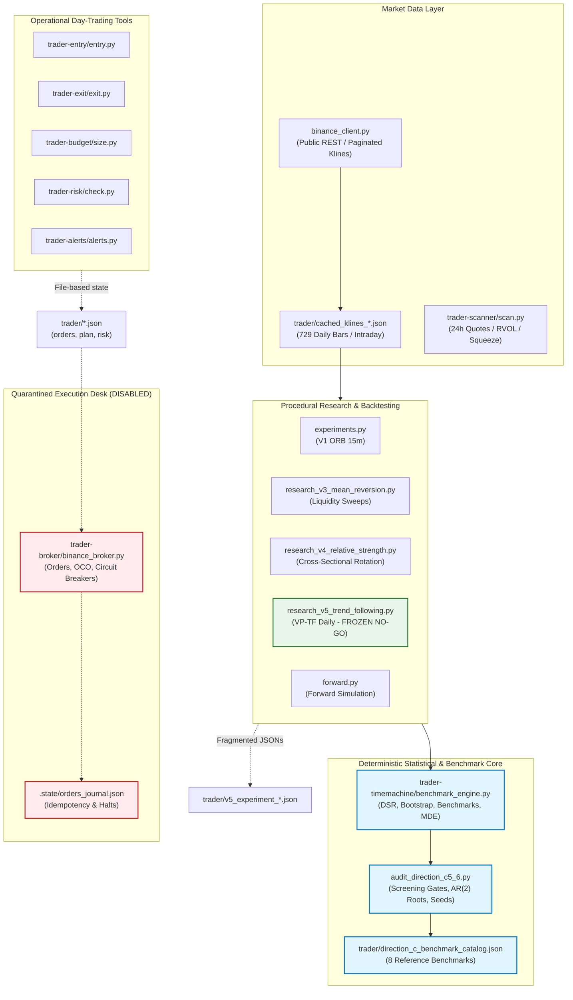

# Architecture Review: Binance Quantitative Framework and Research Agent Transition

**Date:** 2026-10-30  
**Repository:** `E:\projects\binance`  
**Current Status:** Direction C.5.6 Release Gate Complete (`ACCEPT FOR OFFLINE EXPLORATORY COMPARATIVE RESEARCH WITH DOCUMENTED LIMITATIONS`, 517 passing unit tests)  
**Safety & Execution Constraints:** Strictly Offline; All Broker/Exchange Execution Paths Disabled; Strategy V5 Frozen as `VERIFIED NO-GO`; Zero V6 Development; Zero Em Dashes.

---

## 1. Executive Summary

This architecture review establishes the technical baseline for transitioning the Binance quantitative codebase from a human-driven, script-based backtesting and statistical audit suite into an autonomous, evidence-first Quantitative Research Agent.

Over Directions C.1 through C.5.6, this repository established a mathematically rigorous statistical verification engine for crypto strategies, featuring Deflated Sharpe Ratio (DSR), moving-block bootstrap hypothesis testing, multi-diagnostic dependence screening (Bartlett, Ljung-Box, McLeod-Li, and AR(2) companion matrix roots), and benchmark catalogs. However, the system currently exists as decoupled CLI tools and procedural research scripts rather than an integrated agentic framework.

To transition to an autonomous research agent without sacrificing mathematical integrity:
1. **The quantitative Python engine must remain the sole deterministic source of truth.** LLMs must reason, plan, hypothesize, and critique, but never compute metrics or fabricate numbers.
2. **Strategy logic must be decoupled from execution and backtesting without premature legacy refactoring.** A minimal `StrategyInterface` and synthetic demonstration strategy will be built first, leaving V1 through V5 untouched. V5 remains permanently frozen as `VERIFIED NO-GO`.
3. **Execution pathways must be strictly isolated.** All exchange order placement code (`trader-broker/binance_broker.py`, `binance_client.py` write endpoints) must be physically quarantined from the research agent toolset.
4. **An explicit adversarial agent ("Skeptical Researcher") must be structural.** The system must optimize for finding false discoveries, look-ahead bias, and economic infeasibility rather than maximizing backtest Sharpe ratios.
5. **The untouched test dataset must be sealed.** The agent must be blocked at the tool boundary from unconstrained queries to the test partition, with any repeated queries penalized via Haircut Sharpe Ratios and Holm-Bonferroni corrections.

---

## 2. Current Architecture Overview

The repository currently operates as a collection of eleven specialized CLI tools (originally designed as Claude skills) coupled with a dedicated statistical research suite (`trader-timemachine/` and `trader/`).

### 2.1 Current Architecture Diagram

---

## 3. Existing Module Inventory & Categorization

The codebase encompasses 36 primary Python source modules totaling 27,115 lines of code, verified by 517 passing unit tests. A complete machine-readable audit is available in `trader/architecture_inventory.json`.

| Category | Primary Modules | LOC | Key Responsibilities | Current State |
| :--- | :--- | :--- | :--- | :--- |
| **Statistical Core** | `trader-timemachine/benchmark_engine.py`, `audit_direction_c5_6.py`, `audit_direction_c5_4.py`, `audit_trial_count.py` | 3,184 | DSR calculation, moving-block bootstrap, dependence screening (Bartlett, Ljung-Box, McLeod-Li), AR(2) companion matrix roots, deterministic 63-bit seeds, Numba JIT kernels. | **REUSE AS-IS**. Production-ready, fully verified through C.5.6. |
| **Data Ingestion** | `binance_client.py`, `trader/cached_klines_*.json` | 1,038 | Backward-paginated kline downloading, gap detection (`detect_gaps`), window splitting, local caching, Decimal lot/price quantization. | **REUSE AS-IS** (read-only subset). Order execution endpoints strictly quarantined. |
| **Backtesting & Simulation** | `research_v5_trend_following.py`, `research_v4_relative_strength.py`, `research_v3_mean_reversion.py`, `research_htf.py`, `experiments.py`, `timemachine.py` | 5,845 | Monolithic backtesting scripts. Modeling of 0.10% taker fee, 0.05% slippage, trailing stops, chronological data splitting (70% train, 30% test). | **PRESERVE AS-IS / NO REFACTORING**. Legacy baseline code. Do not rewrite. V5 remains frozen. |
| **Risk & Sizing** | `trader-risk/check.py`, `trader-budget/size.py`, `trader-exit/exit.py` | 2,646 | Fractional position sizing, max loss per trade, bracket exit math (ATR stops, 1R/2R targets), account risk validation. | **NEEDS ADAPTER**. Currently CLI tools reading/writing JSON files; need clean functional Python library wrappers. |
| **Market Analysis & Regimes** | `trader-scanner/scan.py`, `trader-entry/entry.py`, `trader-alerts/alerts.py` | 3,369 | Bollinger Band/ATR squeeze detection, RVOL volume expansion, session breakout timing (UTC 00:00, 08:00, 13:30). | **NEEDS ADAPTER**. Rich indicator algorithms must be exposed as programmatic regime detectors for the Market Analyst agent. |
| **External Intelligence** | `trader-news/news.py`, `trader-analyst/facts.py`, `trader-pelosi/ptr.py` | 2,238 | RSS news parsing, SEC EDGAR XBRL facts, Congressional stock disclosures. | **NEEDS ADAPTER / LOW PRIORITY**. Primarily equity-focused; SEC/PTR tools are non-essential for Binance crypto research. |
| **Broker & Execution** | `trader-broker/binance_broker.py`, `trader-broker/binance_client.py`, `trader-broker/ticket.py` | 1,774 | Spot OCO, OTOCO, Futures Algo orders, idempotency journals, emergency position recovery, circuit breakers. | **STRICTLY ISOLATED / DISABLED**. Must never be imported or invoked by the research agent. |

---

## 4. Reusable Components vs. Required Adapters

### 4.1 Directly Reusable Components (Zero Code Modification Needed)
1. **Mathematical & Statistical Engine (`trader-timemachine/benchmark_engine.py`):**
   - Arithmetic Sharpe (`calc_arithmetic_sharpe`), CAGR, annualized volatility, Sortino ratio, max drawdown, skewness, kurtosis.
   - Deflated Sharpe Ratio (`calc_deflated_sharpe_ratio`, `calc_dsr_sensitivity_grid`) with proper standard error scaling under non-normality and selection bias.
   - Paired moving-block bootstrap (`paired_block_bootstrap_test`) with null-centering and finite-sample p-value convention $(k+1)/(B+1)$.
   - Reference benchmark portfolio calculations (`calc_benchmark_cash`, `calc_benchmark_btc_hold`, `calc_benchmark_equal_weight`, `calc_benchmark_50_50_btc`, `calc_benchmark_vol_target_btc`).
   - Anchored walk-forward splitting (`WalkForwardSplitter`).
2. **Dependence Screening & Parity Framework (`trader-timemachine/audit_direction_c5_6.py`):**
   - Multi-diagnostic screening gate: Bartlett autocorrelation test, Ljung-Box, McLeod-Li volatility clustering.
   - AR(2) companion matrix root evaluator (`calc_ar2_companion_roots`): spectral radius threshold $\max |\lambda_i| \ge 0.50$.
   - 63-bit deterministic seed derivation (`derive_audit_seed_63bit`) guaranteeing bit-exact Monte Carlo reproducibility.
3. **Historical Market Data & Caches (`trader/` and `binance_client.py`):**
   - 729 synchronized daily bars for BTC, ETH, SOL, and BNB (2024-10-30 to 2026-10-28) with zero missing timestamps.
   - Gap detection (`detect_gaps`) and backward kline pagination.
   - Exchange filter parsing (`parse_exchange_filters`) and exact Decimal price/qty quantization.

### 4.2 Non-Premature Strategy Adapter Policy
In strict compliance with architectural corrections:
- **No legacy strategy rewrites:** Existing strategies V1, V3, V4, and V5 will not be refactored during initial phases.
- **Minimal Interface & Synthetic Demonstration:** A minimal `StrategyInterface` will be defined, paired with a new `SyntheticSMAStrategy` to prove end-to-end compatibility with `benchmark_engine.py`.
- **Read-Only Data Provider (`MarketDataProvider`):** Wraps public klines and enforces partition boundaries (`TRAIN`, `VALIDATION`, and `TEST`), completely quarantining private broker execution endpoints.

---

## 5. Missing Capabilities for an Autonomous Quant Research Agent

To achieve the product vision of an autonomous, evidence-driven quant research system, several critical components must be built from the ground up:

### 5.1 Missing Component 1: Central Research Orchestrator & State Graph
- **Current Gap:** Research directions have been executed manually by human prompt engineers orchestrating scripts one by one.
- **Required:** A typed state-machine workflow orchestrating the multi-agent cycle:
  `Objective -> Regime Analysis -> Hypothesis Formulation -> Skeptical Review -> Preregistration -> Backtest -> Risk Audit -> Adversarial Audit -> Synthesis -> Decision`.

### 5.2 Missing Component 2: Dedicated Specialized LLM Personas with Adversarial Balancing
- **Current Gap:** Single-agent LLM prompts suffer from confirmation bias, optimizing strategy parameters to report attractive Sharpe ratios.
- **Required:** Strict persona separation governed by `trader/agent_permission_matrix.md`:
  - **Research Director:** Orchestration, state tracking, hypothesis prioritization.
  - **Market Analyst:** Unbiased historical regime and asset correlation characterization.
  - **Strategy Researcher:** Falsifiable hypothesis creation grounded in economic rationale.
  - **Skeptical Researcher:** Structurally independent adversary rewarded for falsifying hypotheses, exposing data leakage, finding look-ahead bias, detecting curve-fitting, and rejecting unviable strategies.
  - **Risk Analyst:** Downside stress-testing, tail risk, friction drag, and liquidity constraints.

### 5.3 Missing Component 3: Relational Research Memory & Experiment Ledger (`research_ledger.db`)
- **Current Gap:** Experiment results are fragmented across 10+ disjoint JSON files (`v5_experiment_registry.json`, `v4_experiment_results.json`, `htf_experiment_results.json`).
- **Required:** An embedded SQLite database (`research_ledger.db`) tracking hypotheses, frozen preregistrations, trial counts ($M_{\text{total}}$), effective degrees of freedom ($M_{\text{eff}}$), and audit verdicts.

### 5.4 Missing Component 4: Deterministic Python Tool Bridges with Preregistration Enforcement
- **Current Gap:** No mechanism for an LLM to safely trigger a backtest or statistical validation without writing ad-hoc python scripts.
- **Required:** Typed Pydantic tool definitions exposing deterministic quantitative engines:
  - `tool_preregister_experiment(...)`
  - `tool_run_deterministic_backtest(...)` (rejects any run lacking an approved preregistration ID)
  - `tool_run_statistical_validation(...)`
  - `tool_unlock_test_vault(...)` (requires human token)

---

## 6. Dependency, Environment, and Integration Risks

### 6.1 Python 3.14.0 Compatibility
- **Environment:** The repository runs on Python 3.14.0 (Windows 64-bit AMD64).
- **Installed Stack:** `numpy 2.4.4`, `pandas 3.0.1`, `scipy 1.17.1`, `numba 0.65.0`, `pydantic 2.12.5`, `openai 2.44.0`, `httpx 0.28.1`, `SQLAlchemy 2.0.52`.
- **Finding:** Core quantitative tools (NumPy, SciPy, Pandas, Numba) and modern Pydantic V2 are functioning smoothly and pass all 517 unit tests.
- **Risk Assessment:** Heavy monolithic agent frameworks (such as full LangChain with 30+ nested sub-packages) introduce deep dependency trees that may experience wheel compilation friction or deprecation warnings on newly released Python versions.
- **Mitigation:** Prefer lightweight, modular dependencies. Implement a native state machine with Pydantic V2 and standard library SQLite.

### 6.2 LLM Vendor Independence
- **Risk:** Hardcoding proprietary prompts or client libraries for a single LLM vendor exposes the research workflow to API outages, pricing shifts, rate limits, and model deprecations.
- **Mitigation:** Implement a provider-agnostic `LLMClient` interface configured via `config.yaml`, supporting Anthropic Claude, OpenAI, Google Gemini, DeepSeek, and local Ollama models.

### 6.3 Repository Invariants and Formatting Gates
- **Repo Rule:** `tests/test_repo.py` enforces strict invariants across every text file in the repository:
  1. Zero em dashes (`\u2014`) anywhere in repository text files.
  2. Root directory structure matches the eleven published skills.
  3. No V1-only legacy skill names.
- **Mitigation:** All agent artifacts and research outputs must reside strictly within `trader/`, and all text generation pipelines must pass through an automated character sanitizer stripping forbidden Unicode characters.

---

## 7. Security and Execution-Isolation Assessment

A primary requirement of the transition is ensuring that the autonomous agent cannot place live or paper orders, access exchange credentials, or interact with execution desks.

### 7.1 Threat Model and Safeguards

| Threat Vector | Severity | Existing Safeguard | Proposed Agent Architectural Safeguard |
| :--- | :--- | :--- | :--- |
| **Accidental Order Placement** | Critical | `binance_broker.py` requires `--confirm-live` flag and defaults to paper testnet. | **Physical Tool Isolation:** The broker module is never registered as a tool for the agent. The agent environment contains zero order execution tools. |
| **Credential Exfiltration** | Critical | API keys are read from environment variables or local configs. | **Environment Stripping:** Agent worker processes run in an environment where `BINANCE_API_KEY` and `BINANCE_API_SECRET` are explicitly unset or stripped. |
| **Look-Ahead Bias via API** | High | Backward pagination strictly enforces timestamps $\le \text{end\_time}$. | **Partition Wall:** Data loaders provide immutable, pre-sliced dataframes matching the partition protocol (Train, Validation, Test). The test split is sealed until final preregistered verification. |
| **Overwriting Historical Ledgers** | High | Historical reports exist as static markdown/JSON in `trader/`. | **Database Immutability:** Experiment records in `research_ledger.db` are append-only. Completed experiments cannot be updated or overwritten. |
| **Hallucinated Performance** | High | Human oversight during audits. | **Deterministic Tool Gate:** The Research Director agent is architecturally blocked from asserting any Sharpe ratio, p-value, or return metric that is not verbatim present in the deterministic tool output. |

---

## 8. Phased Implementation Roadmap and Minimal Prototype

The revised implementation roadmap and vertical slice prototype are detailed in `trader/agent_implementation_plan.md`:
1. **Phase 1: Minimal Strategy Interface, Synthetic Demo & Ledger (Weeks 1-2):** Minimal `StrategyInterface`, `SyntheticSMAStrategy`, read-only `MarketDataProvider` with partition gates, and SQLite ledger schema.
2. **Phase 2: Deterministic Tool Bridges & Preregistration Gate (Weeks 3-4):** Strict tool-boundary preregistration enforcer, DSR/bootstrap bridges, and trial accounting ($M_{\text{total}}, M_{\text{eff}}$).
3. **Phase 3: Multi-Provider LLM Clients & Adversarial Personas (Weeks 5-6):** Provider-agnostic `LLMClient`, persona prompt templates, and adversarial validation harness.
4. **Phase 4: State Machine Orchestrator & Research Release Gate (Weeks 7-8):** Orchestrator graph coordinating the 8-step minimal prototype workflow, automated research dossier generator, and human-in-the-loop gate for sealed test vault access.

---

## 9. Conclusion and Immediate Action

The revised architecture addresses all eight required corrections: protecting the sealed test partition, enforcing preregistration at the tool boundary, tracking effective trial degrees of freedom, avoiding premature legacy strategy refactoring, improving data provenance, and establishing strict agent permission firewalls.

**Action:** Stop and await user review and approval before writing any implementation code.
