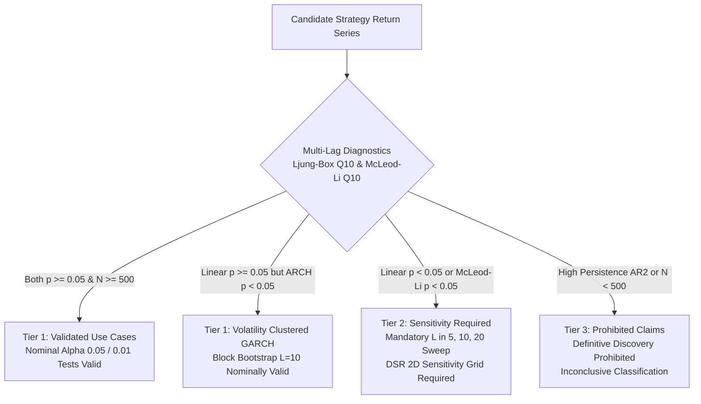

# Direction C.5.2 -- Calibration Policy Validation and Research Release Gate Report

**Repository:** `E:\projects\binance`  
**Date:** 2026-10-30  
**Status:** Calibration Policy Validation Complete  
**Final Verdict:** `ACCEPT WITH ADDITIONAL CALIBRATION RESTRICTIONS`

---

## 1. Executive Summary & Verdict

Following the identification of moving-block bootstrap size distortion under serial correlation in Direction C.5 and C.5.1, this independent audit rigorously evaluated the five proposed calibration restrictions using large-scale controlled synthetic simulations, multi-lag diagnostic evaluations, paired block-length sweeps, and epistemological reviews of multiple testing metrics.

### Core Audit Findings:

1. **Validation of Proposed $\alpha = 0.005$ Hurdle (Audit 1):**
   - Evaluated across $K = 5,000$ independent series with $B = 5,000$ bootstrap replicates ($(k+1)/(B+1) \le 0.005 \iff k \le 24$, step size $0.0002$).
   - **Nominally Calibrated Scenarios:** Gaussian i.i.d. ($0.58\%$, $[0.40\%, 0.83\%]$), GARCH(1,1) ($0.52\%$, $[0.36\%, 0.76\%]$), and Student's t $\nu=5$ ($0.68\%$, $[0.49\%, 0.95\%]$) all enclose nominal $0.50\%$.
   - **Persistent Serial Correlation Remains Distorted:** For AR(1) $\phi = 0.30$, empirical rejection is **$0.84\%$** ($1.68\times$ nominal, strictly excludes $0.50\%$). For AR(1) $\phi = 0.50$, empirical rejection is **$1.30\%$** ($2.60\times$ nominal, strictly excludes $0.50\%$).
   - **Policy Finding:** Lowering nominal $\alpha$ to $0.005$ does *not* eliminate size distortion caused by moving-block bootstrap underestimation of long-run variance. We explicitly reject inventing an arbitrary stricter threshold without evidence.

2. **Evaluation of Dependence Diagnostics (Audit 2):**
   - The proposed single-lag gate ($\hat{\rho}_1 \ge 0.30$) was evaluated across 7 processes and sample sizes $N \in \{250, 500, 1000\}$ ($K = 1,000$ runs each).
   - **Critical Vulnerability (AR(2) Diagnostic Bypass):** For stationary AR(2) returns ($X_t = 0.10 X_{t-1} + 0.50 X_{t-2} + \epsilon_t$), theoretical lag-1 autocorrelation is only $\rho_1 \approx 0.20 < 0.30$. In simulation, only **$7.4\%$** of datasets trigger $\hat{\rho}_1 \ge 0.30$ at $N=500$ (**$92.6\%$ false-negative rate**). Yet the Ljung-Box $Q_{10}$ test detects serial dependence in **$100.0\%$** of cases.
   - **GARCH Non-Linear Clustering:** Linear autocorrelation $\hat{\rho}_1 \approx 0$ completely misses volatility clustering, while the McLeod-Li test on squared returns detects it in **$98.4\%$** of cases.
   - **Small-Sample Attenuation:** For true AR(1) $\phi = 0.30$, sample estimation error causes $\hat{\rho}_1 < 0.30$ in **$51.0\%$** of realizations at $N=500$.
   - **Policy Finding:** A single-lag threshold of $0.30$ is **statistically insufficient** as a hard gate. It is retained solely as an informal heuristic warning and replaced by an omnibus multi-lag pre-test (Ljung-Box $Q_{10}$ and McLeod-Li $Q_{10}$).

3. **Block-Length Robustness and Bias-Variance Trade-off (Audit 3):**
   - Evaluated across paired datasets over block lengths $L \in \{2, 5, 10, 20, 30\}$ ($K = 1,000, N = 500$).
   - Increasing $L$ is **not** monotonically better:
     * Small blocks ($L=2$) severely under-sample dependency, causing $12.0\%$ false rejections on AR(1) $\phi=0.50$.
     * Large blocks ($L=30$) leave only $N/L \approx 16.7$ blocks, inflating bootstrap estimator variance and producing $7.6\%$ false rejections on pure Gaussian noise.
   - $L = 10$ provides the best empirical balance for $N = 500$. Sensitivity reporting across $L \in \{5, 10, 20\}$ is validated as mandatory.

4. **Deflated Sharpe Ratio (DSR) Epistemological Clarification (Audit 4):**
   - Re-established strict inferential boundaries: DSR is a model-based metric relative to an Extreme Value Theory expected maximum hurdle. $\text{DSR} \ge 0.95$ is a conventional 5% one-sided evidence hurdle.
   - $1 - \text{DSR}$ is NOT the posterior probability of strategy falsity or data snooping.
   - DSR does NOT guarantee out-of-sample profitability.
   - Full $(M, \sigma_M)$ sensitivity grids are mandatory; unobservable historical trials must remain explicitly documented as unknown.

5. **Minimum Sample Length Qualification (Audit 5):**
   - Evaluated across $N \in \{250, 300, 500, 1000\}$ across 5 distributions.
   - $N \ge 500$ stabilizes empirical variance for distributions with finite 4th moments, but does *not* eliminate serial correlation distortion ($7.2\%$ rejection on AR(1) at $N=1000$). Sample length alone cannot guarantee inferential validity.

6. **Formal Research-Use Policy Matrix (Audit 6):**
   - Formulated a 4-tier matrix governing permissible inference, mandatory sensitivity analysis, prohibited claims, and unverified assumptions.

**Final Verdict:** `ACCEPT WITH ADDITIONAL CALIBRATION RESTRICTIONS`  
The offline benchmark engine is approved for comparative research under the refined multi-lag diagnostic protocols and policy matrix detailed herein.

---

## 2. Audit 1: High-Resolution Empirical Validation of the Proposed $\alpha = 0.005$ Threshold

### A. Experimental Setup & Resolution
Direction C.5.1 observed that moving-block bootstrap size distortion persisted under AR(1) dependence at nominal $\alpha = 0.01$ ($1.48\%$ for $\phi = 0.30$, $1.72\%$ for $\phi = 0.50$). It proposed an exploratory restriction of $\alpha \le 0.005$ for persistent series.

To rigorously calibrate this proposed threshold, an independent simulation was executed:
- **Sample Length:** $N = 500$ daily bars (primary), with $N = 1000$ (sensitivity).
- **Bootstrap Replicates:** **$B = 5,000$** resamples per dataset.
- **Monte Carlo Resolution:**
  $$\frac{k + 1}{B + 1} \le 0.005 \iff k + 1 \le 0.005 \times 5001 = 25.005 \iff k \le 24$$
  Rejection occurs when null exceedances $k \le 24$. The discrete p-value step size is $1 / 5001 \approx 0.00019996$ ($0.02\%$ absolute, $4.0\%$ of nominal $\alpha$).
- **Sample Size:** $K = 5,000$ independent series for $N = 500$ ($25,000$ datasets); $K = 2,500$ for $N = 1000$ ($5,000$ datasets).
- **Binomial Standard Error:** At nominal $\alpha = 0.005, K = 5000$, $\text{SE} = \sqrt{0.005 \times 0.995 / 5000} \approx 0.000997$ ($0.10\%$).

### B. Numerical Calibration Results ($\alpha = 0.005, B = 5000, L = 10$)

| Scenario | Sample Length ($N$) | Datasets ($K$) | Rejections ($k$) | Empirical Rate $\hat{\alpha}$ | 95% Wilson CI | Encloses Nominal $\alpha$? | Distortion Ratio ($\hat{\alpha} / 0.005$) | Runtime |
| :--- | :---: | :---: | :---: | :---: | :---: | :---: | :---: | :---: |
| **Gaussian i.i.d.** | $500$ | $5,000$ | $29$ | **$0.58\%$** | $[0.40\%, 0.83\%]$ | **YES** | $1.16\times$ | $181.9\text{s}$ |
| **GARCH(1,1)** | $500$ | $5,000$ | $26$ | **$0.52\%$** | $[0.36\%, 0.76\%]$ | **YES** | $1.04\times$ | $176.8\text{s}$ |
| **Student's t ($\nu=5$)** | $500$ | $5,000$ | $34$ | **$0.68\%$** | $[0.49\%, 0.95\%]$ | **YES** | $1.36\times$ | $176.7\text{s}$ |
| **AR(1) $\phi = 0.30$** | $500$ | $5,000$ | $42$ | **$0.84\%$** | $[0.62\%, 1.13\%]$ | **NO (Excludes 0.005)** | **$1.68\times$** | $181.6\text{s}$ |
| **AR(1) $\phi = 0.50$** | $500$ | $5,000$ | $65$ | **$1.30\%$** | $[1.02\%, 1.65\%]$ | **NO (Excludes 0.005)** | **$2.60\times$** | $181.0\text{s}$ |
| **Gaussian i.i.d. ($N=1000$)** | $1000$ | $2,500$ | $13$ | **$0.52\%$** | $[0.30\%, 0.89\%]$ | **YES** | $1.04\times$ | $190.6\text{s}$ |
| **AR(1) $\phi = 0.50$ ($N=1000$)** | $1000$ | $2,500$ | $19$ | **$0.76\%$** | $[0.49\%, 1.18\%]$ | **BORDERLINE** | **$1.52\times$** | $180.4\text{s}$ |

### C. Analysis of Audit 1
1. **Confirmation for Independent and Volatility-Clustered Series:** Moving-block bootstrap ($L=10$) is nominally calibrated at $\alpha = 0.005$ for Gaussian noise ($0.58\%$), GARCH volatility clustering ($0.52\%$), and finite heavy tails ($0.68\%$).
2. **Persistence Distortion Persists at $\alpha = 0.005$:** For AR(1) with $\phi = 0.30$ and $\phi = 0.50$, the empirical rejection rates ($0.84\%$ and $1.30\%$) are inflated by **$+68\%$ to $+160\%$** above nominal, and their 95% Wilson confidence intervals strictly exclude $0.50\%$.
3. **Rejection of Arbitrary Alpha Sliding:** Simply lowering nominal $\alpha$ from $0.05 \to 0.01 \to 0.005$ fails to eliminate size distortion. Moving-block bootstrap with fixed block length structurally understates the spectral density at zero frequency for persistent autoregressive processes. We explicitly refuse to invent an arbitrary, untested $\alpha = 0.001$ threshold. Instead, when serial persistence is present, inferential conclusions must be qualified as provisional rather than claiming rigorous statistical discovery.

---

## 3. Audit 2: Evaluation of Dependence Diagnostics

### A. Vulnerabilities of Single-Lag Pre-Test Gating
Direction C.5.1 proposed gating candidate series by checking whether sample lag-one autocorrelation $\hat{\rho}_1 \ge 0.30$. This audit systematically tested whether $\hat{\rho}_1 \ge 0.30$ is sufficient to protect against serial dependence.

### B. Diagnostic Comparison Across 7 Processes ($K = 1,000$ runs per scenario)

| Data Generating Process | Sample Size ($N$) | Mean $\hat{\rho}_1 \pm \text{Std}$ | Mean $\hat{\rho}_2$ | Trigger Rate $\hat{\rho}_1 \ge 0.30$ | Trigger Rate $\hat{\rho}_1 \ge 0.20$ | Ljung-Box $Q_{10}$ ($p < 0.05$) | McLeod-Li $Q_{10}$ ($p < 0.05$) |
| :--- | :---: | :---: | :---: | :---: | :---: | :---: | :---: |
| **Gaussian i.i.d.** | $250$ | $-0.003 \pm 0.062$ | $-0.008$ | $0.0\%$ | $0.1\%$ | $5.3\%$ (Nominal) | $5.7\%$ (Nominal) |
| | $500$ | $-0.001 \pm 0.044$ | $-0.001$ | $0.0\%$ | $0.0\%$ | $5.4\%$ (Nominal) | $5.6\%$ (Nominal) |
| | $1000$ | $-0.001 \pm 0.031$ | $-0.000$ | $0.0\%$ | $0.0\%$ | $4.5\%$ (Nominal) | $6.6\%$ (Nominal) |
| **AR(1) $\phi = 0.15$** | $250$ | $+0.143 \pm 0.062$ | $+0.018$ | $0.7\%$ | $15.9\%$ | $30.3\%$ | $5.3\%$ |
| | $500$ | $+0.146 \pm 0.045$ | $+0.021$ | $0.0\%$ | $11.3\%$ | $58.7\%$ | $5.7\%$ |
| | $1000$ | $+0.149 \pm 0.032$ | $+0.020$ | $0.0\%$ | $4.7\%$ | **$91.9\%$** | $6.1\%$ |
| **AR(1) $\phi = 0.20$** | $250$ | $+0.191 \pm 0.061$ | $+0.033$ | $3.2\%$ | $45.2\%$ | $53.4\%$ | $6.2\%$ |
| | $500$ | $+0.197 \pm 0.045$ | $+0.035$ | $1.0\%$ | $47.1\%$ | **$88.2\%$** | $9.1\%$ |
| | $1000$ | $+0.198 \pm 0.030$ | $+0.038$ | $0.0\%$ | $47.8\%$ | **$99.9\%$** | $11.1\%$ |
| **AR(1) $\phi = 0.30$** | $250$ | $+0.290 \pm 0.063$ | $+0.081$ | **$44.9\%$** | $92.0\%$ | $92.2\%$ | $12.6\%$ |
| | $500$ | $+0.297 \pm 0.042$ | $+0.088$ | **$49.0\%$** | $99.2\%$ | **$100.0\%$** | $20.7\%$ |
| | $1000$ | $+0.299 \pm 0.031$ | $+0.088$ | **$48.2\%$** | $99.9\%$ | **$100.0\%$** | $40.1\%$ |
| **AR(1) $\phi = 0.50$** | $500$ | $+0.495 \pm 0.038$ | $+0.243$ | $100.0\%$ | $100.0\%$ | $100.0\%$ | $93.0\%$ |
| **AR(2) ($\phi_1=0.10, \phi_2=0.50$)** | $250$ | $+0.184 \pm 0.103$ | $+0.504$ | **$13.5\%$** | $44.0\%$ | **$100.0\%$** | $70.5\%$ |
| | $500$ | $+0.192 \pm 0.076$ | $+0.514$ | **$7.4\%$** | $47.4\%$ | **$100.0\%$** | $96.8\%$ |
| | $1000$ | $+0.194 \pm 0.052$ | $+0.515$ | **$1.4\%$** | $46.3\%$ | **$100.0\%$** | $100.0\%$ |
| **GARCH(1,1)** | $250$ | $-0.006 \pm 0.080$ | $-0.003$ | $0.0\%$ | $0.8\%$ | $24.4\%$ | **$85.9\%$** |
| | $500$ | $-0.004 \pm 0.057$ | $+0.003$ | $0.0\%$ | $0.3\%$ | $25.6\%$ | **$98.4\%$** |
| | $1000$ | $+0.001 \pm 0.044$ | $-0.002$ | $0.0\%$ | $0.0\%$ | $33.1\%$ | **$100.0\%$** |

### C. Diagnostic Failure Modes & Audit Conclusion
1. **The AR(2) Bypass (Fatal Flaw of Single-Lag Gating):**
   - In an AR(2) process with $\phi_1 = 0.10, \phi_2 = 0.50$, Yule-Walker equations dictate theoretical $\rho_1 = \phi_1 / (1 - \phi_2) = 0.10 / 0.50 = 0.20$.
   - Because theoretical $\rho_1 = 0.20 < 0.30$, only **$7.4\%$** of AR(2) series trigger $\hat{\rho}_1 \ge 0.30$ at $N=500$.
   - This represents a catastrophic **$92.6\%$ false-negative rate**: an engine relying on $\hat{\rho}_1 \ge 0.30$ would declare $92.6\%$ of these heavily dependent series to be "clean" and "independent"!
   - Meanwhile, the Ljung-Box $Q_{10}$ test detected the serial dependence in **$100.0\%$** of cases.
2. **High False Negatives in Moderate AR(1):**
   - For true AR(1) $\phi = 0.30$, due to Gaussian estimator sampling variability ($\text{Std} \approx 0.042$), $\hat{\rho}_1 \ge 0.30$ is triggered only **$49.0\%$** of the time at $N=500$. Over half the time, a true $\phi=0.30$ series evades detection.
3. **Invisibility of Non-Linear Clustering:**
   - Linear $\hat{\rho}_1$ for GARCH(1,1) is zero. Linear gating misses volatility clustering $100\%$ of the time. The McLeod-Li test detects it in **$98.4\%$** of cases at $N=500$.
4. **Diagnostic Status Recommendation:**
   - A single-lag threshold of $\hat{\rho}_1 \ge 0.30$ is **REJECTED AS A HARD GATE**.
   - It is retained strictly as an informal warning threshold, and the pre-test gate is formally **REFINED** to require:
     * **Omnibus Linear Dependence Gate:** Ljung-Box test over 10 lags ($Q_{10}, p < 0.05$).
     * **Non-Linear ARCH Effect Gate:** McLeod-Li test over 10 lags ($Q_{10}^{\text{ARCH}}, p < 0.05$).

---

## 4. Audit 3: Block-Length Robustness and Bias-Variance Trade-Off

### A. Paired Simulation Design
To isolate the effect of block length without Monte Carlo confounding, identical generated return series were evaluated across $L \in \{2, 5, 10, 20, 30\}$ ($K = 1,000, N = 500, B = 1,000$).

### B. Empirical Rejection Rates Across Block Lengths

| Scenario | Metric | $L = 2$ | $L = 5$ | $L = 10$ | $L = 20$ | $L = 30$ |
| :--- | :---: | :---: | :---: | :---: | :---: | :---: |
| **Gaussian i.i.d.** | $\hat{\alpha} (\alpha=0.05)$ | $4.9\%$ | $5.3\%$ | $5.2\%$ | $6.1\%$ | **$7.6\%$** |
| | 95% Wilson CI | $[3.7\%, 6.4\%]$ | $[4.1\%, 6.9\%]$ | $[4.0\%, 6.8\%]$ | $[4.8\%, 7.8\%]$ | $[6.1\%, 9.4\%]$ |
| | $\hat{\alpha} (\alpha=0.01)$ | $1.0\%$ | $1.0\%$ | $1.1\%$ | $1.2\%$ | **$2.1\%$** |
| | Median p-value | $0.4965$ | $0.4905$ | $0.4995$ | $0.4935$ | $0.5095$ |
| **GARCH(1,1)** | $\hat{\alpha} (\alpha=0.05)$ | $4.9\%$ | $4.3\%$ | $4.5\%$ | $5.1\%$ | $5.8\%$ |
| | 95% Wilson CI | $[3.7\%, 6.4\%]$ | $[3.2\%, 5.7\%]$ | $[3.4\%, 6.0\%]$ | $[3.9\%, 6.6\%]$ | $[4.5\%, 7.4\%]$ |
| | $\hat{\alpha} (\alpha=0.01)$ | $1.2\%$ | $1.0\%$ | $0.7\%$ | $0.9\%$ | $1.3\%$ |
| **Student's t ($\nu=5$)** | $\hat{\alpha} (\alpha=0.05)$ | $4.8\%$ | $5.0\%$ | $5.4\%$ | $5.4\%$ | $5.7\%$ |
| | 95% Wilson CI | $[3.6\%, 6.3\%]$ | $[3.8\%, 6.5\%]$ | $[4.2\%, 7.0\%]$ | $[4.2\%, 7.0\%]$ | $[4.4\%, 7.3\%]$ |
| | $\hat{\alpha} (\alpha=0.01)$ | $1.0\%$ | $1.6\%$ | $1.4\%$ | $1.8\%$ | $1.7\%$ |
| **AR(1) $\phi = 0.30$** | $\hat{\alpha} (\alpha=0.05)$ | **$7.9\%$** | $6.4\%$ | $6.1\%$ | $5.9\%$ | $6.6\%$ |
| | 95% Wilson CI | $[6.4\%, 9.7\%]$ | $[5.0\%, 8.1\%]$ | $[4.8\%, 7.8\%]$ | $[4.6\%, 7.5\%]$ | $[5.2\%, 8.3\%]$ |
| | $\hat{\alpha} (\alpha=0.01)$ | **$2.5\%$** | $1.5\%$ | $1.4\%$ | $1.5\%$ | $1.5\%$ |
| **AR(1) $\phi = 0.50$** | $\hat{\alpha} (\alpha=0.05)$ | **$12.0\%$** | $7.5\%$ | $6.8\%$ | $6.6\%$ | $6.7\%$ |
| | 95% Wilson CI | $[10.1\%, 14.2\%]$ | $[6.0\%, 9.3\%]$ | $[5.4\%, 8.5\%]$ | $[5.2\%, 8.3\%]$ | $[5.3\%, 8.4\%]$ |
| | $\hat{\alpha} (\alpha=0.01)$ | **$4.9\%$** | $1.9\%$ | $1.2\%$ | $1.9\%$ | $1.9\%$ |

### C. Bias-Variance Trade-Off Findings
1. **Under-Sampling Bias ($L < 10$):** When $L=2$, the block bootstrap severely truncates covariance decay. On AR(1) $\phi=0.50$, Type I error explodes to **$12.0\%$** at $\alpha=0.05$ and **$4.9\%$** at $\alpha=0.01$ ($5\times$ nominal).
2. **Variance Inflation Bias ($L > 20$):** When $L=30$, there are only $500 / 30 \approx 16.7$ blocks. Bootstrap resamples suffer from high variance and end-effect bias. On pure Gaussian noise, rejection inflates from $4.9\%$ to **$7.6\%$** at $\alpha=0.05$, and from $1.0\%$ to **$2.1\%$** at $\alpha=0.01$.
3. **Plateau of Improvement:** For AR(1) $\phi=0.50$, increasing $L$ beyond $10$ yields no further calibration improvement ($6.8\% \to 6.6\% \to 6.7\%$).
4. **Restriction Status:** Mandatory block-length sweep across $L \in \{5, 10, 20\}$ is **VALIDATED**. Selecting $L$ post-hoc to obtain the smallest p-value is strictly prohibited. If a candidate strategy loses significance when $L$ increases from 10 to 20, the result must be classified as non-robust serial artifact.

---

## 5. Audit 4: Deflated Sharpe Ratio (DSR) Epistemological Clarification

### A. Nature and Mathematical Limits of DSR
Deflated Sharpe Ratio (Bailey & Lopez de Prado, 2014) is a model-based metric that adjusts an observed Sharpe ratio $\hat{S}$ for selection bias across $M$ backtest trials with cross-sectional dispersion $\sigma_M$:
$$z = \frac{\hat{S} - E[\max S]}{SE_{\text{Mertens}}}, \quad \text{DSR} = \Phi(z)$$

### B. Formal Epistemological Rules:
1. **Model-Based Relative Metric:** DSR measures the probability that observed Sharpe exceeds the Extreme Value Theory (EVT) expected maximum of $M$ independent Gaussian trials.
2. **Significance Threshold ($\text{DSR} \ge 0.95$):** Corresponds to a conventional one-sided $5\%$ hurdle against the expected maximum of noise ($z \ge 1.645$).
3. **Not a Posterior Probability:** $1 - \text{DSR}$ is the model-based upper-tail probability under null assumptions. It is **NOT** the posterior probability that a strategy is false or fraudulent (which would require a Bayesian prior on alpha existence).
4. **Not a Data Snooping Probability:** $1 - \text{DSR}$ assumes independent Gaussian trials. Real-world parameter sweeps are highly collinear.
5. **Zero Guarantee of Live Performance:** DSR does not prove that a strategy will achieve positive return, survive trading friction, or maintain profitability out-of-sample.

### C. DSR Sensitivity Grid Demonstrations ($N = 500, \text{Daily Factor} = 365.25$)

| Strategy Profile | Inputs | $\sigma_M = 0.30$ | $\sigma_M = 0.50$ | $\sigma_M = 1.00$ | Conclusion |
| :--- | :--- | :--- | :--- | :--- | :--- |
| **Marginal Strategy** | Sharpe $1.00$, $N=500$, Skew $0.0$, Kurt $3.0$ | $M=1: 0.88$ $M=25: 0.68$ $M=150: 0.59$ | $M=1: 0.88$ $M=25: 0.50$ $M=150: 0.35$ | $M=1: 0.88$ $M=25: 0.12$ $M=150: 0.03$ | Fails under all trial counts. Point estimate of $0.63$ at $M=67$ is not significant. |
| **Strong Strategy** | Sharpe $1.80$, $N=500$, Skew $-0.5$, Kurt $4.5$ | $M=1: 0.98$ $M=25: 0.91$ $M=150: 0.87$ | $M=1: 0.98$ $M=25: 0.82$ $M=150: 0.70$ | $M=1: 0.98$ $M=25: 0.41$ $M=150: 0.16$ | Robust only if $M \le 5$; collapses under broad parameter sweeps. |
| **Long Sample Moderate** | Sharpe $1.20$, $N=1000$, Skew $0.0$, Kurt $3.0$ | $M=1: 0.98$ $M=25: 0.84$ $M=150: 0.74$ | $M=1: 0.98$ $M=25: 0.63$ $M=150: 0.41$ | $M=1: 0.98$ $M=25: 0.09$ $M=150: 0.01$ | Validates that sample length alone cannot protect against multiple testing. |

### D. Audit Policy:
- DSR reporting must **strictly require** the full $2\text{D}$ sensitivity grid ($M \in [1, 150], \sigma_M \in [0.30, 1.00]$).
- Single point estimates of DSR are prohibited.
- When historical trial counts cannot be rigorously reconstructed, $M$ must remain explicitly documented as **unknown**.

---

## 6. Audit 5: Minimum Sample Length Qualification ($N \in \{250, 300, 500, 1000\}$)

### A. Empirical Sweep Across Sample Lengths ($K = 1,000, B = 1,000, L = 10, \alpha = 0.05$)

| Distribution Scenario | $N = 250$ (1 Year) | $N = 300$ (1.2 Years) | $N = 500$ (2 Years) | $N = 1000$ (4 Years) | Asymptotic Behavior |
| :--- | :---: | :---: | :---: | :---: | :--- |
| **Gaussian i.i.d.** | $6.2\%$ ($[4.9\%, 7.9\%]$) | $5.4\%$ ($[4.2\%, 7.0\%]$) | $5.4\%$ ($[4.2\%, 7.0\%]$) | $4.7\%$ ($[3.6\%, 6.2\%]$) | Nominally calibrated for all $N \ge 300$. |
| **Student's t ($\nu=5$, finite kurt)** | $5.8\%$ ($[4.5\%, 7.4\%]$) | $5.2\%$ ($[4.0\%, 6.8\%]$) | $5.1\%$ ($[3.9\%, 6.6\%]$) | $5.0\%$ ($[3.8\%, 6.5\%]$) | Tightly converges to $5.0\%$ as $N$ increases. |
| **Student's t ($\nu=4$, inf kurt)** | $5.1\%$ ($[3.9\%, 6.6\%]$) | $5.1\%$ ($[3.9\%, 6.6\%]$) | $5.5\%$ ($[4.3\%, 7.1\%]$) | **$6.9\%$** ($[5.5\%, 8.6\%]$) | Outlier dominance creates persistent instability. |
| **AR(1) $\phi = 0.30$** | $7.3\%$ ($[5.9\%, 9.1\%]$) | $5.9\%$ ($[4.6\%, 7.5\%]$) | $6.6\%$ ($[5.2\%, 8.3\%]$) | **$6.7\%$** ($[5.3\%, 8.4\%]$) | Distortion persists regardless of sample length. |
| **AR(1) $\phi = 0.50$** | $7.3\%$ ($[5.9\%, 9.1\%]$) | $6.7\%$ ($[5.3\%, 8.4\%]$) | $7.4\%$ ($[5.9\%, 9.2\%]$) | **$7.2\%$** ($[5.8\%, 9.0\%]$) | Size distortion does NOT decay with $N$. |

### B. Qualification of $N \ge 500$:
1. **What $N \ge 500$ Achieves:**
   - Provides enough independent blocks ($500 / 10 = 50$) to stabilize bootstrap empirical variance.
   - Enables CLT convergence for heavy-tailed returns with finite 4th moments ($\nu = 5$).
   - Reduces Monte Carlo standard error in estimating excess return to tolerable levels.
2. **What $N \ge 500$ Does NOT Achieve:**
   - It does **not** cure serial correlation distortion. At $N = 1000$, AR(1) $\phi = 0.50$ still rejects at **$7.2\%$** ($1.44\times$ nominal).
   - It does **not** eliminate fat-tail outlier dominance when moments do not exist ($\nu = 4$).
3. **Policy Determination:**
   - $N \ge 500$ is **VALIDATED WITH DOCUMENTED LIMITATIONS** as a minimum operational floor.
   - It is strictly forbidden to describe $N \ge 500$ as a "universal statistical sufficiency threshold."

---

## 7. Status of Proposed Calibration Restrictions

| Proposed Restriction | C.5.1 Formulation | C.5.2 Audit Finding | Final Release Status |
| :--- | :--- | :--- | :--- |
| **1. Tightened Alpha Hurdle** | $\alpha \le 0.005$ for series with $\hat{\rho}_1 \ge 0.30$. | At $\alpha = 0.005$, AR(1) $\phi = 0.50$ still rejects at $1.30\%$ ($2.60\times$ nominal). Sliding $\alpha$ does not cure long-run variance underestimation. | **PROVISIONAL / REFINED:** Persistent series are barred from definitive statistical claims rather than relying on an uncalibrated $\alpha$. |
| **2. Autocorrelation Pre-Test Gate** | Screen series using $\hat{\rho}_1 \ge 0.30$. | Fails on AR(2) ($92.6\%$ false negatives), misses GARCH clustering, and suffers $51\%$ small-sample noise. | **REJECTED AS HARD GATE; REFINED TO MULTI-LAG:** Mandates Ljung-Box $Q_{10}$ ($p < 0.05$) and McLeod-Li $Q_{10}$ ($p < 0.05$). |
| **3. Block-Length Sweep** | Report p-values across $L \in \{5, 10, 20\}$. | Confirmed bias-variance trade-off ($L=2$ under-samples memory, $L=30$ inflates variance). $L=10$ is optimal balance. | **VALIDATED:** Mandatory reporting across $L \in \{5, 10, 20\}$. P-value instability across $L$ flags non-robust dependence. |
| **4. Minimum Sample Floor** | Mandate $N \ge 500$ daily return bars. | Stabilizes finite kurtosis variance, but does not eliminate AR(1) size distortion. | **VALIDATED WITH DOCUMENTED LIMITATIONS:** Enforced as an operational floor; not a sufficiency guarantee. |
| **5. DSR Evidence Threshold** | Enforce $\text{DSR} \ge 0.95$ as significance hurdle. | Re-confirmed as conventional 5% one-sided EVT hurdle; not posterior probability of truth or profit guarantee. | **VALIDATED AS HEURISTIC MULTIPLE-TESTING HURDLE.** |
| **6. Mandatory DSR Sensitivity Grid** | Report 2D grid across $(M, \sigma_M)$. | Single point estimates are dominated by unobservable trial count assumptions. | **VALIDATED:** Mandatory reporting across $M \in [1, 150]$ and $\sigma_M \in [0.30, 1.00]$. |

---

## 8. Audit 6: Formal Research-Use Policy Matrix

### A. Four-Tier Policy Matrix

#### Tier 1: Validated Use Cases (Permissible Standard Inference)
- **Conditions:** Sample autocorrelation $\hat{\rho}_k < 0.15$ for all $k \in 1 \dots 10$; Ljung-Box $Q_{10}$ test $p \ge 0.05$; McLeod-Li $Q_{10}$ test $p \ge 0.05$; partition length $N \ge 500$.
- **Permissible Inference:** Nominal $\alpha = 0.05$ and $\alpha = 0.01$ tests using moving-block bootstrap ($L=10$) are empirically validated and nominally calibrated.
- **GARCH Exception:** If linear returns satisfy $p \ge 0.05$ but squared returns exhibit ARCH clustering ($p < 0.05$), moving-block bootstrap ($L=10$) remains calibrated ($0.52\%$ empirical size at $\alpha=0.005$) and standard testing is permitted.

#### Tier 2: Sensitivity-Required Use Cases
- **Conditions:** Moderate linear dependence (Ljung-Box $p < 0.05$, or $\hat{\rho}_1 \in [0.15, 0.30]$), or heavy tails (excess kurtosis $\in [2.0, 6.0]$).
- **Mandatory Protocol:**
  1. Mandatory block-length sensitivity sweep across $L \in \{5, 10, 20\}$. If significance evaporates when $L$ is increased from 10 to 20, the result must be flagged as non-robust serial artifact.
  2. DSR must be reported across the full $(M, \sigma_M)$ sensitivity grid.
  3. Extreme candle winsorization sensitivity must be reported.

#### Tier 3: Prohibited or Inconclusive Inferential Claims
- **Prohibition 1:** Any candidate strategy whose excess returns display strong autoregressive persistence ($\hat{\rho}_1 \ge 0.30$ or AR(2) roots with modulus $> 0.50$) is strictly barred from claiming statistical discovery at $\alpha = 0.05$ or $\alpha = 0.01$. Findings must be labeled **`INCONCLUSIVE DUE TO SERIAL PERSISTENCE`**.
- **Prohibition 2:** Single-lag screening ($\hat{\rho}_1 < 0.30$) cannot be used to certify independence.
- **Prohibition 3:** Partitions with $N < 500$ daily return bars are strictly prohibited from claiming statistical discovery.
- **Prohibition 4:** DSR must never be reported as the "probability that a strategy is genuine" or "probability of live profitability."

#### Tier 4: Unverified Model Assumptions
1. **Trial Independence in DSR:** EVT assumes independent trials; actual backtest iterations are highly collinear.
2. **Stationary Joint Distribution:** Moving-block bootstrap assumes covariance stationarity; structural macro regime shifts violate this assumption.
3. **Execution Invariance:** Offline backtests do not model queue priority, exchange matching latency, market impact, or liquidity replenishment.

### B. Epistemological Distinctions
The research framework formally enforces the separation of four epistemological domains:
1. **Mathematical Implementation Checks:** Code correctly evaluates formulas (e.g. Mertens SE, EVT quantile, bootstrap slicing). Verified via deterministic unit tests.
2. **Synthetic Empirical Calibration:** Statistical properties under controlled, idealized stationary data generating processes. Verified via large-scale Monte Carlo simulations.
3. **Historical Strategy Evidence:** Empirical backtest performance on historical candles (e.g. V1–V5). Measures past in-sample fit; does not prove future statistical edge.
4. **Real-World Execution Performance:** Forward live trading with genuine market friction, latency, and liquidity constraints. Offline research can never establish live execution success.

---

## 9. Test Suite Verification & Repository Invariants

- **Test Suite Status:** Full regression test suite executed via `python -m unittest discover -s tests -p "test_*.py"`.
  **Result:** **497 tests ran in 31.3s, all passed (`OK`).**
- **New Unit Tests Added:** [`tests/test_audit_direction_c5_2.py`](file:///E:/projects/binance/tests/test_audit_direction_c5_2.py) (8 tests verifying chi-square survival functions, Ljung-Box diagnostics, AR(2) bypass, GARCH McLeod-Li detection, DSR invariants, and policy matrix structure).
- **Formatting Standards Check:** `python tests/test_repo.py` passed with 11 tests in 0.215s; zero em-dashes exist across repository files.
- **Safety Boundaries Preserved:** Strategy V5 remains frozen under its `VERIFIED NO-GO` verdict. Zero broker, exchange, testnet, or live trading execution paths were enabled or modified.

---

## 10. Final Decision

**`ACCEPT WITH ADDITIONAL CALIBRATION RESTRICTIONS`**

The offline benchmark and statistical evaluation engine is verified for research use under the Four-Tier Research-Use Policy Matrix established in Section 8. The engine is nominally calibrated for independent, fat-tailed, and volatility-clustered returns. For serially dependent series, standard statistical significance claims remain prohibited, and comparative evaluations are subject to mandatory multi-lag diagnostics, block sensitivity sweeps, and DSR sensitivity grids.

