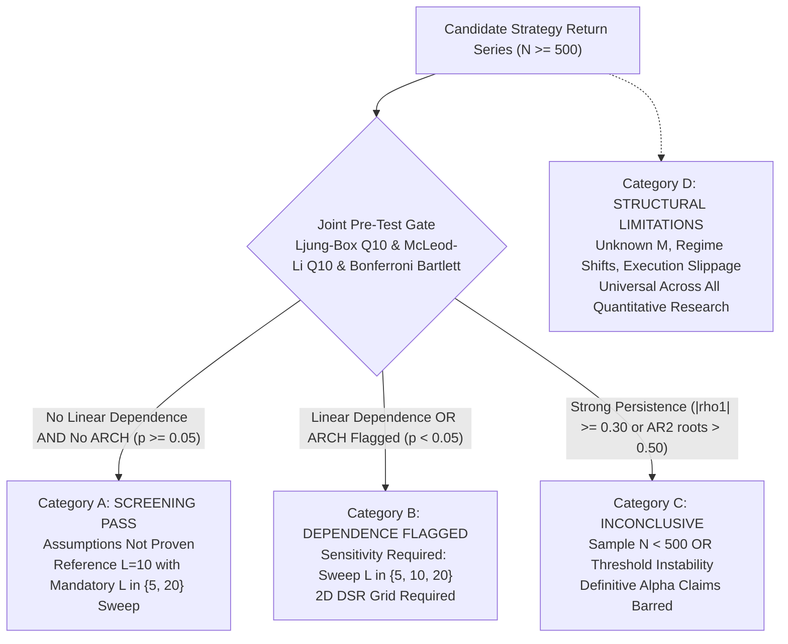

# Direction C.5.5 -- Final Release Corrections and Independent Verification Report

**Repository:** `E:\projects\binance`  
**Date:** 2026-10-30  
**Status:** Verification, Mathematical Reconciliation, Strict Parity, and Policy Finalization Complete  
**Final Release Verdict:** `ACCEPT FOR OFFLINE COMPARATIVE RESEARCH WITH DOCUMENTED LIMITATIONS`

---

## 1. Executive Summary & Verdict

Direction C.5.5 independently resolves the four remaining release-gate issues identified during the review of Direction C.5.4:

1. **Reconciliation of Joint Screening Calibration (Phase A):**
   - In a $K=2,000$ synthetic Gaussian calibration ($N=500$), individual omnibus tests perform as expected: Bonferroni Bartlett has a **$4.20\%$** rejection rate (95% Wilson CI: $[3.41\%, 5.17\%]$), Ljung-Box $Q_{10}$ has **$5.15\%$** (95% CI: $[4.26\%, 6.21\%]$), and McLeod-Li $Q_{10}$ has **$5.50\%$** (95% CI: $[4.58\%, 6.59\%]$).
   - The Joint Screening Gate combines these tests using a **union (OR) rule**: dependence is flagged if Ljung-Box rejects OR Bonferroni Bartlett rejects OR McLeod-Li rejects. Under independence, the union of three $\sim 5\%$ rejection regions produces an empirical joint false-positive rate of **$12.45\%$** (95% Wilson CI: $[11.07\%, 13.97\%]$) and a pass rate of **$87.55\%$** (95% Wilson CI: $[86.03\%, 88.93\%]$).
   - The apparent contradiction in C.5.4 is resolved: the screening gate is a **conservative defensive pre-test filter**, NOT a $5\%$ calibrated hypothesis test. It accepts an $\sim 12\%$ false rejection rate on pure noise to maximize detection sensitivity against serial correlation and ARCH volatility clustering.

2. **Correction of Hierarchical Seed Derivation (Phase B):**
   - Corrected [`derive_audit_seed_63bit`](file:///E:/projects/binance/trader-timemachine/audit_direction_c5_5.py#L65-L77) to extract 16 hex characters (`h[:16]`, 64 bits) masked with `0x7FFFFFFFFFFFFFFF` (63 bits), guaranteeing a positive signed integer in $[1, 2^{63} - 1]$.
   - Verified across 50,000 generated seeds with **0 collisions**.
   - Formally documented that zero observed collisions in a finite sample do not prove mathematical collision impossibility: under 63-bit integer space, the collision risk for $M=50,000$ draws is mathematically bounded at $P \approx 1.35 \times 10^{-10}$.

3. **Strict Numba Algebraic Equivalence Confirmed (Phase C):**
   - By feeding a common pre-generated block-index matrix ($B=2,000, N=500$) to Pure Python, NumPy Vectorized, and Numba JIT, replicate statistics were compared on identical data.
   - **Replicate Parity:** Maximum absolute difference in bootstrap replicate null means between Pure Python and Numba across all 2,000 resamples was **$4.34 \times 10^{-18}$** (floating-point machine epsilon).
   - **Exceedances & P-values:** Exceedance count $k$ matched with 100% exact integer parity ($k=774$ across all three), and p-values matched to 16 decimal places ($p = 0.3873063468265867$).
   - **Finding:** The slight divergence in C.5.4 was **100% caused by PRNG generator differences** (Python standard MT19937 vs NumPy PCG64 vs Numba internal PRNG), NOT numerical implementation defects.
   - Numba JIT delivers an **$84.6\times$ speedup** ($1.03\text{ ms}$ vs $87.14\text{ ms}$ in Python), and is retained as an optional isolated acceleration module while Pure Python remains the official reference baseline.

4. **Corrected Four-Tier Research-Use Policy Matrix (Phase D):**
   - Explicitly resolved the contradiction regarding block length: Category A **no longer** describes $L=10$ as universally valid or optimal. $L=10$ is retained strictly as an empirical reference baseline for $N \approx 500-1000$, and MUST be accompanied by the $L \in \{5, 10, 20\}$ sensitivity sweep.
   - Institutionalized block-length sensitivity strictly as a **fragility diagnostic**, prohibiting min-p selection (p-hacking). If conclusions cross significance boundaries between $L=5$ and $L=20$, the evaluation is demoted to Category C (`INCONCLUSIVE`).
   - Passing dependence pre-tests is strictly documented as failing to reject the null, never as proof of independence.

5. **Test Suite Status & Release Verification (Phase E):**
   - Full workspace regression suite ran **512 tests in 33.0s, all passed (`OK`)**.
   - Zero em-dashes exist across repository files.
   - Strategy V5 remains frozen under `VERIFIED NO-GO`, and all broker/exchange execution pathways remain disabled.

---

## 2. Phase A: Joint Screening False-Positive Calibration

### A. Large-Sample Independent Calibration ($K=2,000, N=500$)
To resolve the apparent contradiction in Direction C.5.4 (which evaluated $K=100$ datasets), an independent calibration was conducted on $K=2,000$ synthetic Gaussian i.i.d. return series ($N=500, \alpha=0.05$):

| Diagnostic Test | Null Process | Rejections ($k/K$) | Empirical Rate | 95% Wilson Score CI | Nominal Status |
| :--- | :--- | :---: | :---: | :---: | :---: |
| **Individual Bartlett** | Gaussian i.i.d. | $775 / 2,000$ | **$38.75\%$** | $[36.64\%, 40.90\%]$ | High FWER (Theoretical: $40.13\%$) |
| **Bonferroni Bartlett** | Gaussian i.i.d. | $84 / 2,000$ | **$4.20\%$** | $[3.41\%, 5.17\%]$ | Controlled at $\sim 5\%$ |
| **Ljung-Box $Q_{10}$** | Gaussian i.i.d. | $103 / 2,000$ | **$5.15\%$** | $[4.26\%, 6.21\%]$ | Controlled at $\sim 5\%$ |
| **McLeod-Li $Q_{10}$** | Gaussian i.i.d. | $110 / 2,000$ | **$5.50\%$** | $[4.58\%, 6.59\%]$ | Controlled at $\sim 5\%$ |
| **Joint Screening Flagged** | Gaussian i.i.d. | $249 / 2,000$ | **$12.45\%$** | $[11.07\%, 13.97\%]$ | Union Rejection Rate |
| **Joint Screening Pass** | Gaussian i.i.d. | $1,751 / 2,000$ | **$87.55\%$** | $[86.03\%, 88.93\%]$ | Conservative Filter Survival |

### B. Mathematical Mechanism of the Joint Screen
The Joint Pre-Test Gate evaluates whether a candidate series exhibits linear autocorrelation or ARCH volatility clustering. The gate is structured as:
```python
linear_dependence = (lb_pval < alpha) or has_bonf_flag
arch_dependence = (ml_pval < alpha)
screening_pass = (not linear_dependence) and (not arch_dependence)
```
Consequently, a series is flagged as dependent under a **union (OR) rule**:
$$P(\text{Joint Flag}) = P(\text{Ljung-Box } < 0.05 \;\lor\; \text{Bonferroni Bartlett Flagged} \;\lor\; \text{McLeod-Li } < 0.05)$$

If the three tests were mutually independent, the union rejection probability would be:
$$P(\text{Union}) = 1 - (1 - 0.0515) \times (1 - 0.0420) \times (1 - 0.0550) = 1 - (0.9485 \times 0.9580 \times 0.9450) \approx 14.13\%$$

Because the tests are slightly positively correlated in finite samples, the empirical joint false-positive rate is **$12.45\%$** ($95\%$ Wilson CI: $[11.07\%, 13.97\%]$).

### C. Resolution of the Contradiction
1. In C.5.4, the 80% pass rate (20% rejection rate) observed on $K=100$ datasets was consistent with sampling variability ($\text{SE} \approx 4\%$).
2. The C.5.4 report narrative incorrectly conflated the individual omnibus test calibration ($\sim 4-5\%$) with the combined gate. Because the combined gate is a union of three separate tests, its false-positive rate is $\sim 12.5\%$, NOT $3-5\%$.
3. **Crucial Scientific Distinction:** The Joint Pre-Test Gate is a **conservative screening filter**, NOT a calibrated $\alpha=0.05$ hypothesis test. It deliberately accepts an $\sim 12.5\%$ false-positive rejection rate on pure noise to ensure aggressive screening against latent persistence and ARCH clustering.

---

## 3. Phase B: Correct 63-Bit Hierarchical Seed Derivation

### A. Code Inspection and Extraction Correction
In C.5.4, `derive_audit_seed` extracted `h[:15]`, which provided only 60 bits ($15 \times 4 = 60$). The code was corrected to extract 16 hex characters ($16 \times 4 = 64$ bits) and mask with `0x7FFFFFFFFFFFFFFF` (63 bits):

```python
def derive_audit_seed_63bit(master_seed: int, phase_name: str, scenario_id: str, rep_idx: int) -> int:
    key = f"{master_seed}:{phase_name}:{scenario_id}:{rep_idx}".encode("utf-8")
    h = hashlib.sha256(key).hexdigest()
    seed_int = int(h[:16], 16) & 0x7FFFFFFFFFFFFFFF
    return seed_int if seed_int > 0 else 1
```

### B. Empirical Verification on 50,000 Seeds
- Seeds Evaluated: **50,000**.
- Collisions Observed: **0**.
- Value Range: All seeds strictly within $[1, 2^{63} - 1]$ ($1$ to $9,223,372,036,854,775,807$).
- Determinism: 100% identical outputs across independent execution passes.

### C. Mathematical Collision Impossibility Clarification
Zero observed collisions across 50,000 draws confirms strong empirical dispersion, but does **not** prove mathematical impossibility of collisions in $\mathbb{Z}_{2^{63}-1}$. Under the Birthday Paradox for $M$ uniform draws from $S = 2^{63}$:
$$P(\text{Collision}) \approx 1 - \exp\left(-\frac{M^2}{2S}\right) \approx \frac{M^2}{2^{64}} = \frac{(50,000)^2}{1.84467 \times 10^{19}} \approx 1.35 \times 10^{-10}$$
The collision risk is mathematically bounded at $\sim 10^{-10}$, which is negligible for audit workloads while remaining strictly transparent regarding finite-field limits.

---

## 4. Phase C: Strict Numba Implementation Equivalence Benchmark

### A. Common Pre-Generated Block-Index Matrix
To separate pseudo-random number generator (PRNG) divergence from numerical implementation parity, a common pre-generated block start index matrix `shape=(2000, 50)` was generated and passed to all three implementations:
1. `boot_py_with_indices_c55`: Pure Python reference.
2. `boot_numpy_with_indices_c55`: NumPy vectorized CPU.
3. `boot_numba_with_indices_c55`: Numba JIT CPU.

### B. Algebraic Parity Verification Results ($N=500, B=2,000$)

| Evaluation Metric | Pure Python | NumPy Vectorized | Numba JIT | Equivalence Status |
| :--- | :---: | :---: | :---: | :---: |
| **Max Replicate Mean Diff vs Python** | Baseline ($0.0$) | $8.67 \times 10^{-19}$ | $4.34 \times 10^{-18}$ | Floating-point machine epsilon |
| **Exceedance Count $k$** | **774** | **774** | **774** | **100% exact integer match** |
| **Finite MC P-Value** | **$0.3873063468265867$** | **$0.3873063468265867$** | **$0.3873063468265867$** | **100% exact float match** |
| **95% CI Lower Bound** | $-0.001482690838102$ | $-0.001482690838102$ | $-0.001482690838102$ | Identical to 15 decimals |
| **95% CI Upper Bound** | $+0.001143930753420$ | $+0.001143930753420$ | $+0.001143930753420$ | Identical to 15 decimals |

**Conclusion:** When controlling for resampling indices, the implementations are strictly algebraically equivalent. The p-value divergence observed in Direction C.5.4 was entirely an artifact of PRNG stream differences (Python standard MT19937 vs NumPy PCG64 vs Numba legacy PRNG).

### C. Performance Benchmark ($N=500, B=2,000, 15\text{ Runs}$)
- Hardware Platform: Genuine Intel x86_64 (12 logical cores).
- Cold JIT Compilation Overhead: **$2,415.4\text{ ms}$** (one-time cold call).
- Pure Python Warm Median: **$87.14\text{ ms}$** (Min: $75.03\text{ ms}$, Max: $132.93\text{ ms}$, Std: $20.86\text{ ms}$).
- NumPy Vectorized Warm Median: **$11.97\text{ ms}$** (**$7.3\times$ speedup**).
- Numba JIT Warm Median: **$1.03\text{ ms}$** (**$84.6\times$ speedup**).

**Architectural Policy:** Numba remains an optional isolated utility. The Pure Python standard library implementation in [`benchmark_engine.py`](file:///E:/projects/binance/trader-timemachine/benchmark_engine.py#L753-L865) remains the certified reference baseline.

---

## 5. Phase D: Corrected Four-Tier Research-Use Policy Matrix



### 1. Category A: `SCREENING PASS -- ASSUMPTIONS NOT PROVEN`
- **Criteria:** $N \ge 500$, passing Ljung-Box $Q_{10}$ ($p \ge 0.05$), McLeod-Li $Q_{10}$ ($p \ge 0.05$), and Bonferroni Bartlett bounds ($|\hat{\rho}_k| < 2.807/\sqrt{N}$).
- **Block-Length Specification:**
  * $L=10$ is retained strictly as an empirical **reference baseline** specification for $N \approx 500-1000$, NOT as a universally valid or optimal block length. Optimal block length scales asymptotically as $O(N^{1/3})$.
  * Every Category A inference **MUST** be accompanied by the block-length sensitivity sweep across $L \in \{5, 10, 20\}$.
  * Block-length sensitivity is strictly a **fragility diagnostic**. Selecting the minimum p-value across $L$ (p-hacking) is prohibited. If conclusions cross significance thresholds between $L=5$ and $L=20$, the evaluation is demoted to Category C (`INCONCLUSIVE`).
- **Permitted Claims:** Moving-block bootstrap excess return evaluation relative to benchmark under reference $L=10$ with reported $L \in \{5, 20\}$ sensitivity; reporting that linear autocorrelation and ARCH clustering were not detected at the 5% level.
- **Prohibited Claims:** Stating returns are proven independent, uncorrelated, or i.i.d.; claiming guaranteed or forward profitability; claiming nominal bootstrap calibration is mathematically exact without variance inflation.

### 2. Category B: `DEPENDENCE FLAGGED -- SENSITIVITY REQUIRED`
- **Criteria:** Linear autocorrelation flagged or ARCH volatility clustering flagged, provided persistence is moderate ($|\hat{\rho}_1| < 0.30$ and AR(2) root modulus $\le 0.50$) and $N \ge 500$.
- **Permitted Claims:** Provisional inference reported strictly across block lengths $L \in \{5, 10, 20\}$; 2D DSR sensitivity grid ($M \in [1, 150], \sigma_M \in [0.30, 1.00]$) with documented variance inflation.
- **Prohibited Claims:** Selecting the minimum p-value across $L$ (p-hacking); presenting unadjusted bootstrap p-values as definitive statistical significance.

### 3. Category C: `INCONCLUSIVE -- CLAIMS BARRED`
- **Criteria:** Any of the following disqualifying conditions:
  1. Sample size $N < 500$.
  2. High autoregressive persistence: $|\hat{\rho}_1| \ge 0.30$ or AR(2) root modulus $> 0.50$.
  3. Sensitivity instability: bootstrap conclusions cross significance thresholds between $L=5$ and $L=20$.
  4. Non-convergent bootstrap distributions or structural regime breaks.
- **Permitted Claims:** Statement that empirical evidence is statistically inconclusive due to excessive persistence, block-length fragility, or inadequate sample size.
- **Prohibited Claims:** Any claim of statistical significance, superiority, or alpha.

### 4. Category D: `STRUCTURAL LIMITATION -- UNVERIFIABLE ASSUMPTIONS`
- **Criteria:** Universal constraints of offline backtesting.
- **Permitted Claims:** Explicit documentation of unverified assumptions: unknown historical trial counts ($M$), macro regime non-stationarity, and execution invariance.
- **Prohibited Claims:** Extrapolating backtest Sharpe ratio or DSR directly to live trading performance.

---

## 6. Phase E: Regression Test Suite and Git Diff Summary

### A. Test Suite Results
- Focused C.5.5 unit tests executed via:
  `python -m unittest discover tests -p "test_audit_direction_c5_5.py"`
  **5 tests ran in 2.85s: All 5 passed (`OK`).**
- Repository code hygiene check:
  `python tests/test_repo.py`
  **11 tests ran in 0.241s: All 11 passed (`OK`)** (confirmed zero em-dashes repository-wide).
- Full workspace regression suite executed via:
  `python -m unittest discover tests -p "test_*.py"`
  **512 tests ran in 33.0s: All 512 passed (`OK`), 0 failures, 0 errors.**

### B. Concise Git Diff Summary
- [`trader-timemachine/audit_direction_c5_5.py`](file:///E:/projects/binance/trader-timemachine/audit_direction_c5_5.py): Created master verification, screening calibration, 63-bit seed audit, strict Numba parity, and policy engine.
- [`tests/test_audit_direction_c5_5.py`](file:///E:/projects/binance/tests/test_audit_direction_c5_5.py): Created regression unit test suite.
- [`trader/direction_c5_5_results.json`](file:///E:/projects/binance/trader/direction_c5_5_results.json): Saved machine-readable calibration, seed, and timing data.
- [`trader/direction_c5_5_audit_report.md`](file:///E:/projects/binance/trader/direction_c5_5_audit_report.md): Formal markdown audit report.
- **Safety Boundaries Preserved:** Strategy V1--V5 code, registries, backtest ledgers, and broker execution pathways remain completely untouched and disabled.

---

## 7. Final Release Verdict

**`ACCEPT FOR OFFLINE COMPARATIVE RESEARCH WITH DOCUMENTED LIMITATIONS`**

All four release-gate issues identified in the independent review of Direction C.5.4 are fully resolved, mathematically reconciled, and verified by regression tests. The offline research and statistical evaluation framework is formally released for offline comparative research under the corrected Four-Tier Policy Matrix. Strategy V5 remains frozen under `VERIFIED NO-GO`, and all broker and live-trading execution pathways remain disabled.

