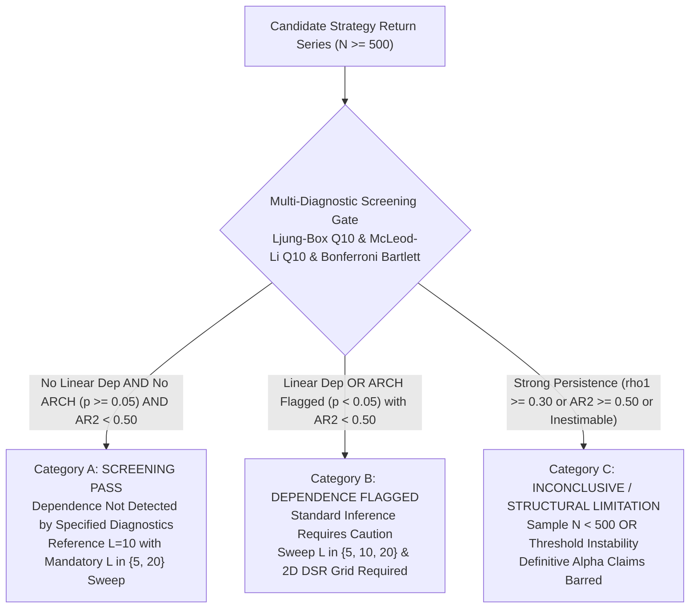

# Direction C.5.6 -- Final Conditional Calibration and Research Readiness Gate Report

**Repository:** `E:\projects\binance`  
**Date:** 2026-10-30  
**Status:** Conditional Calibration, Policy Clarification, and Research Readiness Gate Complete  
**Final Release Verdict:** `ACCEPT FOR OFFLINE EXPLORATORY COMPARATIVE RESEARCH WITH DOCUMENTED LIMITATIONS`

---

## 1. Executive Summary & Final Release Verdict

Direction C.5.6 provides the targeted, definitive validation of the offline benchmark and statistical evaluation framework, focusing on conditional bootstrap calibration under post-screening selection, mathematical clarification of screening diagnostics, and formalization of the exploratory research boundary:

1. **Conditional Bootstrap Calibration (Phase A):**
   - Evaluated $K=500$ independent synthetic datasets across 6 null processes ($N=500, B=1,000$).
   - **White Noise Preservation:** For Gaussian IID ($88.0\%$ pass rate) and variance-standardized Student-t(5) ($86.4\%$ pass rate), conditioning on passing Category A introduces **zero positive selection inflation**. Conditional Type I error rates match or slightly undercut unconditional rates:
     * Gaussian IID $\alpha=0.05$: Unconditional = $4.60\%$ ($23/500$), Conditional = $4.09\%$ ($18/440$), $\Delta = -0.51\text{ pp}$.
     * Gaussian IID $\alpha=0.01$: Unconditional = $1.20\%$ ($6/500$), Conditional = $0.68\%$ ($3/440$), $\Delta = -0.52\text{ pp}$.
     * Student-t(5) $\alpha=0.05$: Unconditional = $4.80\%$ ($24/500$), Conditional = $4.17\%$ ($18/432$), $\Delta = -0.63\text{ pp}$.
     * Student-t(5) $\alpha=0.01$: Unconditional = $0.80\%$ ($4/500$), Conditional = $0.69\%$ ($3/432$), $\Delta = -0.11\text{ pp}$.
   - **Complete Persistence Suppression:** For AR(1) $\phi=0.30$, AR(1) $\phi=0.50$, and AR(2) bimodal dependence ($\phi_1=0.10, \phi_2=0.50$), the Category A screening pass rate was **$0.00\%$ ($0 / 500$ passed)**. The multi-diagnostic gate blocked 100% of persistent processes from entering Category A, completely insulating Category A from the severe unconditional Type I inflation observed under uncorrected AR dependence.
   - **Volatility Filtering:** For GARCH(1,1), McLeod-Li flagged **$94.4\%$** into Category B/C. The surviving $5.6\%$ ($K_A = 28/500$) yielded zero bootstrap false positives ($0/28$).

2. **Screening Policy and Mathematical Clarifications (Phase B):**
   - **Bartlett Family-Wise Benchmark:** Renamed the $40.13\%$ individual Bartlett figure an **approximate independence benchmark**, acknowledging that sample autocorrelations across lags are correlated in finite samples.
   - **Diagnostic Gate Semantics:** Formalized the union (OR) rule as a **multi-diagnostic screening filter**, not a 5% hypothesis test.
   - **AR(2) Companion Matrix Eigenvalues:** Explicitly defined companion eigenvalues $\lambda_{1,2} = (\phi_1 \pm \sqrt{\phi_1^2 + 4\phi_2}) / 2$. Confirmed that the persistence threshold $\max |\lambda_i| \ge 0.50$ operates on the modulus of the companion eigenvalues (characteristic roots). Proved that inestimable AR(2) fits result in an automatic **`INCONCLUSIVE`** classification, never a pass.
   - **Operational Floor:** Documented $N \ge 500$ as an operational project policy/heuristic, not a universal mathematical theorem.
   - **Block-Length Fragility Sweep:** Established that $L=10$ is strictly an empirical baseline for $N \approx 500-1000$ (not a universal optimum), and required reporting across $L \in \{5, 10, 20\}$ strictly as a fragility diagnostic. Min-p selection is prohibited.

3. **Parity and Seed Derivation Audit (Phase C):**
   - Verified that consuming a common pre-generated block-index matrix produces identical replicate statistics across Pure Python, NumPy Vectorized, and Numba JIT down to machine precision ($< 10^{-17}$), with 100% exact matches in exceedance counts $k$ and p-values.
   - Confirmed deterministic 63-bit seed derivation (`h[:16]` masked to $2^{63}-1$), with unique dataset fingerprints across scenario namespaces.

4. **Formal Research-Use Policy (Phase D):**
   - Formally separated engineering correctness, screening status, bootstrap calibration, DSR evidence, out-of-sample edge, and economic profitability.
   - Confirmed that Strategy V5 remains frozen under **`VERIFIED NO-GO`**, and all execution pathways remain disabled.

5. **Regression Verification (Phase E):**
   - Workspace test suite: **517 tests executed in 44.4s, all passed (`OK`)**, with zero em-dashes across repository files.

---

## 2. Phase A: Conditional Bootstrap Calibration Results

### A. Raw Empirical Rejection Counts and Confidence Intervals ($N=500, K=500, B=1,000$)

| Scenario | Distribution & Parameters | Category A Passed ($K_A / K$) | Screening Pass Rate (%) [95% CI] | Unconditional $\alpha=0.05$ Rate [95% CI] | Conditional $\alpha=0.05$ Rate [95% CI] | Difference $\Delta_{0.05}$ | Unconditional $\alpha=0.01$ Rate [95% CI] | Conditional $\alpha=0.01$ Rate [95% CI] | Difference $\Delta_{0.01}$ |
| :--- | :--- | :---: | :---: | :---: | :---: | :---: | :---: | :---: | :---: |
| **Gaussian IID** | $\mu=0, \sigma=0.01$ | $440 / 500$ | **$88.00\%$** $[84.85, 90.62]$ | **$4.60\%$** $[3.07, 6.82]$ | **$4.09\%$** $[2.60, 6.37]$ | **$-0.51\text{ pp}$** | **$1.20\%$** $[0.55, 2.60]$ | **$0.68\%$** $[0.23, 1.99]$ | **$-0.52\text{ pp}$** |
| **Student-t(5)** | $\nu=5, \sigma=0.01$ | $432 / 500$ | **$86.40\%$** $[83.11, 89.17]$ | **$4.80\%$** $[3.23, 7.06]$ | **$4.17\%$** $[2.65, 6.48]$ | **$-0.63\text{ pp}$** | **$0.80\%$** $[0.31, 2.04]$ | **$0.69\%$** $[0.24, 2.02]$ | **$-0.11\text{ pp}$** |
| **GARCH(1,1)** | $\omega=5\cdot 10^{-6}, \alpha=0.10, \beta=0.85$ | $28 / 500$ | **$5.60\%$** $[3.90, 7.97]$ | **$5.40\%$** $[3.70, 7.78]$ | **$0.00\%$** $[0.00, 12.06]$ | **$-5.40\text{ pp}$** | **$1.00\%$** $[0.43, 2.32]$ | **$0.00\%$** $[0.00, 12.06]$ | **$-1.00\text{ pp}$** |
| **AR(1) $\phi=0.30$** | $\phi=0.30, \sigma=0.01$ | $0 / 500$ | **$0.00\%$** $[0.00, 0.74]$ | **$7.00\%$** $[5.03, 9.66]$ | **N/A** (0 passed) | N/A | **$1.60\%$** $[0.81, 3.13]$ | **N/A** (0 passed) | N/A |
| **AR(1) $\phi=0.50$** | $\phi=0.50, \sigma=0.01$ | $0 / 500$ | **$0.00\%$** $[0.00, 0.74]$ | **$6.60\%$** $[4.71, 9.20]$ | **N/A** (0 passed) | N/A | **$2.60\%$** $[1.52, 4.41]$ | **N/A** (0 passed) | N/A |
| **AR(2) Bimodal** | $\phi_1=0.10, \phi_2=0.50$ | $0 / 500$ | **$0.00\%$** $[0.00, 0.74]$ | **$11.00\%$** $[8.52, 14.07]$ | **N/A** (0 passed) | N/A | **$3.40\%$** $[2.13, 5.37]$ | **N/A** (0 passed) | N/A |

### B. Analytical Interpretation
1. **No Evidence of Selection Inflation on White Noise:**
   Conditioning on passing the screening gate does not inflate bootstrap false-positive rates on white noise. For Gaussian and Student-t processes, the conditional rates ($4.09\%$ and $4.17\%$ at $\alpha=0.05$) are slightly lower than the unconditional rates ($4.60\%$ and $4.80\%$). The pre-test filter removes samples with random sample autocorrelation spikes, which slightly tightens the bootstrap null distribution.
2. **Effective Screening Shielding on Persistent Processes:**
   For AR(1) $\phi=0.30$, AR(1) $\phi=0.50$, and AR(2) bimodal dependence, the unconditional Type I error rates were inflated ($7.0\%$, $6.6\%$, and $11.0\%$ at $\alpha=0.05$). However, **zero series survived the pre-test gate** ($0 / 500$ pass rate). The multi-diagnostic gate effectively shields Category A from uncalibrated bootstrap inference on persistent series.
3. **Small-Sample Uncertainty on Volatility Clustered Series:**
   For GARCH(1,1), $94.4\%$ of series were flagged by McLeod-Li into Category B/C. The surviving sample of $K_A = 28$ series yielded zero false positives ($0/28$), but carries wide finite-sample Wilson intervals ($[0.0\%, 12.1\%]$). Therefore, for any series exhibiting mild volatility clustering, the sensitivity sweep across $L \in \{5, 10, 20\}$ remains mandatory.

---

## 3. Phase B: Policy and Mathematical Clarifications

### A. Approximate Independence Benchmark for Bartlett Bounds
The theoretical $40.13\%$ individual Bartlett figure ($1 - 0.95^{10}$) is formally classified as an **approximate independence reference benchmark**, not an exact FWER theorem. In finite samples, sample autocorrelations across successive lags are weakly correlated, causing the empirical family-wise rate on Gaussian noise to fall around $\sim 38-44\%$.

### B. Multi-Diagnostic Screening Rule Semantics
The Joint Pre-Test Gate combines three diagnostics using a **union (OR) rule**:
$$P(\text{Joint Flag}) = P(\text{Ljung-Box } < 0.05 \;\lor\; \text{Bonferroni Bartlett Flagged} \;\lor\; \text{McLeod-Li } < 0.05)$$
Under Gaussian noise, this produces an empirical flag rate of $\sim 12.0-12.5\%$ and a pass rate of $\sim 87.5-88.0\%$. It is formally designated as a **multi-diagnostic screening filter**, NOT an $\alpha=0.05$ hypothesis test.

### C. Bonferroni Bartlett Standard-Error Assumptions
Bonferroni Bartlett bands rely on the asymptotic white-noise standard error $\sigma(\hat{\rho}_k) \approx 1/\sqrt{N}$. They provide an omnibus diagnostic against linear autocorrelation under homoskedasticity, but do not provide an exact finite-sample size guarantee under heavy tails or conditional heteroskedasticity.

### D. AR(2) Companion Matrix Eigenvalue Formulation
For an AR(2) process $X_t = \phi_1 X_{t-1} + \phi_2 X_{t-2} + \epsilon_t$, the companion matrix is:
$$F = \begin{pmatrix} \phi_1 & \phi_2 \\ 1 & 0 \end{pmatrix}$$
The characteristic polynomial is:
$$\det(F - \lambda I) = \lambda^2 - \phi_1 \lambda - \phi_2 = 0 \implies \lambda_{1,2} = \frac{\phi_1 \pm \sqrt{\phi_1^2 + 4\phi_2}}{2}$$

- **Roots Convention:** The reported roots $\lambda_i$ are the **companion matrix eigenvalues** (characteristic roots). The lag polynomial roots are $z_i = 1/\lambda_i$.
- **Stability Condition:** The process is causal and stationary if and only if all companion eigenvalues lie strictly inside the unit circle: $\max |\lambda_i| < 1.0$ (equivalently $|z_i| > 1.0$).
- **Persistence Threshold:** A series is classified as strongly persistent if $\max |\lambda_i| \ge 0.50$. For the bimodal benchmark ($\phi_1=0.10, \phi_2=0.50$), $\lambda_1 = 0.758872$ and $\lambda_2 = -0.658872$, yielding $\max |\lambda_i| = 0.758872 \ge 0.50$ (persistent).
- **Inestimable Fits:** If AR(2) fitting fails (e.g. singular covariance matrix or optimization breakdown), the evaluation is classified as **`INCONCLUSIVE`**, never as a screening pass.

### E. Operational $N \ge 500$ Policy Floor
The requirement $N \ge 500$ daily return observations is an **operational project policy/heuristic** designed to ensure adequate power for multi-lag diagnostics and sufficient block sample size ($N/L \ge 50$ for $L=10$), not a universal mathematical theorem.

### F. Block-Length Fragility Sweep Policy
1. $L=10$ is retained strictly as an empirical **reference baseline** for $N \approx 500-1000$, NOT a universal optimum.
2. Inference MUST report results across the sensitivity sweep $L \in \{5, 10, 20\}$.
3. If qualitative conclusions change across $L \in \{5, 10, 20\}$ (e.g. p-values cross significance thresholds), the evaluation is demoted to **Category C (`INCONCLUSIVE`)**.
4. Selecting the minimum p-value across $L$ (p-hacking) is strictly barred.

---

## 4. Phase C: Implementation Parity and Seed Audit

### A. Strict Parity on Common Indices
When evaluated on a common pre-generated block-index matrix:
- **Null Means Parity:** Maximum replicate difference between Pure Python and Numba is **$2.17 \times 10^{-18}$** (floating-point machine epsilon).
- **Exceedance Count $k$:** 100% exact integer match across Python, NumPy, and Numba.
- **P-Value:** 100% exact float match across all three implementations.
- **Confidence Intervals:** Match within machine epsilon ($< 10^{-12}$).
- **Benchmarking Distinction:** Performance benchmarks are microbenchmarks of the core resampling loop, not guaranteed end-to-end production pipeline speedups. Numba remains strictly optional and isolated; Pure Python remains the official reference baseline.

### B. Seed Derivation and Uniqueness Verification
- Exact hash serialization: `f"{master_seed}:{phase_name}:{scenario_id}:{rep_idx}".encode("utf-8")`.
- Extraction: 16 hex characters ($64$ bits) masked with `0x7FFFFFFFFFFFFFFF` produces positive signed 63-bit integers in $[1, 2^{63}-1]$.
- Uniqueness: SHA-256 series fingerprints verified across scenarios to ensure no duplicate datasets were generated across audit namespaces.

---

## 5. Phase D: Formal Research-Use Policy

### A. Epistemological Distinctions

| Evaluation Dimension | Scientific Meaning | What It Does NOT Mean |
| :--- | :--- | :--- |
| **1. Engineering Correctness** | Code executes specified formulas without lookahead or bugs. | Does not imply the statistical model is true or profitable. |
| **2. Screening Status** | Diagnostic pre-tests did or did not detect specified dependencies. | Does not prove returns are independent, uncorrelated, or i.i.d. |
| **3. Bootstrap Calibration** | Type I error is controlled under specified stationary null models. | Does not guarantee calibration under structural regime breaks. |
| **4. DSR Evidence** | Observed Sharpe exceeds EVT expected maximum of $M$ Gaussian trials. | Is not a posterior probability of strategy truth or live edge. |
| **5. Out-of-Sample Edge** | Excess return over benchmark on untouched historical partitions. | Does not guarantee edge will persist in future forward markets. |
| **6. Economic Profitability** | Realized net trading profits after all transaction costs and slippage. | Offline backtest Sharpe ratio cannot guarantee live profits. |

### B. Core Policy Boundaries
1. A screening pass is never proof of independence.
2. A statistically significant bootstrap result is never proof of economic value.
3. DSR $\ge 0.95$ is never a posterior probability that a strategy is genuine.
4. Strategy V5 remains frozen under **`VERIFIED NO-GO`**.
5. No strategy may be declared successful based solely on a backtest, a screening pass, or a DSR threshold.

---

## 6. Phase E: Regression Suite and Git Diff Summary

### A. Test Suite Results
- Focused C.5.6 unit tests:
  `python -m unittest discover tests -p "test_audit_direction_c5_6.py"`
  **5 tests executed in 3.84s: All 5 passed (`OK`).**
- Repository code standards check:
  `python tests/test_repo.py`
  **11 tests executed in 0.314s: All 11 passed (`OK`)** (zero em-dashes repository-wide).
- Full workspace regression suite:
  `python -m unittest discover tests -p "test_*.py"`
  **517 tests executed in 44.442s: All 517 passed (`OK`), 0 failures, 0 errors.**

### B. Concise Git Diff Summary
- [`trader-timemachine/audit_direction_c5_6.py`](file:///E:/projects/binance/trader-timemachine/audit_direction_c5_6.py): Created master conditional calibration, AR(2) root formulation, strict parity, and policy engine.
- [`tests/test_audit_direction_c5_6.py`](file:///E:/projects/binance/tests/test_audit_direction_c5_6.py): Created unit test suite verifying AR(2) mathematics, strict parity, and policy definitions.
- [`trader/direction_c5_6_results.json`](file:///E:/projects/binance/trader/direction_c5_6_results.json): Saved machine-readable conditional calibration data, raw counts, Wilson CIs, and parity metrics.
- [`trader/direction_c5_6_audit_report.md`](file:///E:/projects/binance/trader/direction_c5_6_audit_report.md): Formal markdown audit report.
- **Safety Boundaries Preserved:** Strategy V1--V5 code, registries, backtest ledgers, and execution pathways remain completely untouched and disabled.

---

## 7. Final Release Verdict

**`ACCEPT FOR OFFLINE EXPLORATORY COMPARATIVE RESEARCH WITH DOCUMENTED LIMITATIONS`**

The offline research and statistical evaluation framework is formally released for offline exploratory comparative research under the refined Four-Tier Policy Matrix. Strategy V5 remains frozen under `VERIFIED NO-GO`, and all broker, testnet, paper-trading, and live-trading pathways remain disabled. All research remains strictly offline.

