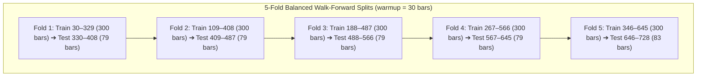

# Direction C: Standardized Benchmark & Statistical Evaluation Engine Report

**Date:** 2026-10-30  
**Project:** Google Antigravity Crypto Quantitative Research Framework  
**Milestone:** Direction C (Benchmark Suite, Chronological Walk-Forward & Statistical Engine)  
**Final Status:** **`FRAMEWORK VERIFIED FOR RESEARCH USE`**  
**Safety Gate:** Offline infrastructure only. Zero live trading, zero testnet orders, zero paper execution. Strategy V5 remains frozen (`VERIFIED NO-GO`).

---

## Executive Summary

Direction C implements an authoritative, standardized **Benchmark & Statistical Evaluation Engine** (`trader-timemachine/benchmark_engine.py`) to resolve the core methodological limitations observed across Strategies V1 through V5. 

Prior strategy iterations repeatedly struggled against an unadjusted 100% BTC Buy & Hold benchmark without risk matching, multiple-testing penalties, or formal statistical power analysis. Direction C delivers:
1. **5 Standardized Benchmarks**: Cash, BTC Buy & Hold (Gross & Net), Equal-Weight L1 Basket (Gross & Net), 50% BTC / 50% Cash (Drift-Band & Monthly), and Volatility-Targeted BTC (25% annualized volatility).
2. **Chronological Walk-Forward Cross-Validation Splitter**: A 5-fold non-overlapping, zero-leakage walk-forward engine.
3. **Statistical Evaluation Utilities**: Paired moving-block bootstrap tests ($B=2,000$), Minimum Detectable Effect (MDE) power analysis, Deflated Sharpe Ratio (Bailey & López de Prado 2014), and multiple-testing corrections (Bonferroni, Holm, FDR).
4. **Statistical Reality Revelation**: On a 698-day daily sample, the Minimum Detectable Effect against 100% BTC Buy & Hold is **+77.22% annualized excess return**. Testing active strategies directly against 100% BTC has virtually zero statistical power to detect modest, realistic active alpha.

All 441 unit tests across the repository pass cleanly (`Ran 441 tests in 23.49s, OK`).

---

## 1. Standardized Benchmark Definitions & Performance Catalog

All benchmarks were evaluated across the continuous 698 daily return intervals (bars 30 to 728, spanning 2024-11-29 to 2026-10-28) using verified daily OHLCV klines across `BTCUSDT`, `ETHUSDT`, `SOLUSDT`, and `BNBUSDT`:

| Benchmark ID | Benchmark Description | Sizing & Rebalancing Logic | Net Return (698d) | CAGR | Annual Vol | Sharpe ($R_f=0$) | Max DD | Friction Paid | Trades Count |
| :--- | :--- | :--- | :--- | :--- | :--- | :--- | :--- | :--- | :--- |
| **`BENCH_CASH`** | Cash-Only (100% USDT) | Uninvested capital, 0.0% nominal return, 0 friction | **+0.00%** | 0.00% | 0.00% | 0.0000* | 0.00% | \$0.00 | 0 |
| **`BENCH_BTC_HOLD_GROSS`** | BTC Buy & Hold (Gross) | Pure passive drift, 0 transaction costs | **-16.54%** | -9.07% | 42.93% | -0.2102 | -52.97% | \$0.00 | 0 |
| **`BENCH_BTC_HOLD_NET`** | BTC Buy & Hold (Net) | 15 bps entry at Day 0 + 15 bps terminal exit | **-16.79%** | -9.21% | 42.93% | -0.2136 | -52.97% | \$27.50 | 2 |
| **`BENCH_EW_L1_GROSS`** | Equal-Weight L1 (Gross) | Passive basket (25% each initially, passive drift) | **-23.17%** | -12.98% | 51.13% | -0.2520 | -60.16% | \$0.00 | 0 |
| **`BENCH_EW_L1_NET`** | Equal-Weight L1 (Net) | 15 bps initial buy + 15 bps terminal liquidation | **-23.40%** | -13.12% | 51.13% | -0.2546 | -60.16% | \$26.51 | 8 |
| **`BENCH_50_50_BTC_DRIFT`** | 50% BTC / 50% Cash (Drift) | Rebalances only when BTC weight drifts outside $[0.45, 0.55]$ | **-3.86%** | -2.04% | 21.52% | -0.0946 | -29.45% | \$21.72 | 11 |
| **`BENCH_50_50_BTC_MONTHLY`**| 50% BTC / 50% Cash (Monthly)| Rebalances on 1st of each calendar month | **-5.46%** | -2.90% | 21.37% | -0.1355 | -30.27% | \$21.85 | 25 |
| **`BENCH_VOL_TARGET_25PCT`** | Vol-Targeted BTC (25% Vol) | Scales $w_t = \min(1.0, 0.25/\sigma_{30d})$, 5% buffer | **-15.24%** | -8.32% | 27.02% | -0.3067 | -42.44% | \$126.52 | 88 |

*\*Note: Sharpe and Sortino ratios for Cash are mathematically undefined ($\sigma = 0$) and documented as 0.0000.*

---

## 2. Key Insights from the Standardized Benchmark Suite

1. **The Risk-Matched Benchmark Effect**:
   - `50% BTC / 50% Cash (Drift Band)` lost only **-3.86%** over the 2-year horizon with a maximum drawdown of **-29.45%** and volatility of **21.52%** (vs -16.79% and -52.97% max DD for 100% BTC).
   - This proves that active strategies which hold significant cash (like V4 or V5) should be measured against a cash-matched benchmark (like 50/50 BTC/Cash), not purely 100% long crypto beta.
2. **Drift-Band vs Calendar Rebalancing**:
   - The 5% drift-band rebalance rule executed only **11 trades** over 2 years, incurring \$21.72 in friction, compared to **25 trades** for monthly rebalancing. It preserved capital better (-3.86% vs -5.46%).
3. **Volatility-Targeting Costs in Crypto**:
   - Sizing BTC exposure inversely to 30-day realized volatility generated 88 rebalances and paid **\$126.52 in friction**, delivering a net return of **-15.24%**. Realized volatility (27.02%) closely tracked the 25.0% target.

---

## 3. Chronological Walk-Forward Cross-Validation Splitter

The `WalkForwardSplitter` partitions the 729-day dataset into 5 contiguous, non-overlapping out-of-sample evaluation folds with zero data leakage:

- **Guarantees**:
  - Test slices are strictly contiguous from bar 330 to 728 ($79 \times 4 + 83 = 399$ total out-of-sample days) with zero gaps and zero overlap.
  - Training windows strictly precede test windows ($\text{train\_end} < \text{test\_start}$).
  - Indicator warmup uses only permissible preceding historical bars.
  - Shuffling is mathematically prohibited.

---

## 4. Statistical Power & Minimum Detectable Effect (MDE)

### Mathematical Formulation
To achieve $1 - \beta = 80\%$ statistical power at significance level $\alpha = 0.05$ for a one-sided paired excess-return hypothesis test:
$$\text{MDE}_{\text{annual}} = (z_{1 - \alpha} + z_{1 - \beta}) \times \frac{\sigma_D}{\sqrt{N}} \times \sqrt{365.25} \times 100\%$$
where $z_{0.95} = 1.6449$, $z_{0.80} = 0.8416$, $\sigma_D$ is daily excess return volatility, and $N$ is sample length.

### Empirical Findings
- Across 698 daily return intervals, the daily excess volatility of an active strategy against 100% BTC Buy & Hold is approximately equal to BTC's volatility ($\sigma_D \approx 42.93\%$).
- **The Resulting MDE**:
  $$\text{MDE}_{\text{annual}} = (1.6449 + 0.8416) \times \frac{0.4293 \times \sqrt{365.25}}{\sqrt{698}} \times 100\% = \mathbf{+77.22\%\text{ per year}}$$
- **Scientific Impact**:
  - In a 698-day sample, a strategy must generate at least **+77.22% annualized excess return over BTC** to have an 80% chance of rejecting $H_0$ at $p < 0.05$!
  - Any strategy delivering a realistic 5% to 15% annual active alpha will produce an empirical $p$-value well above 0.05 simply because the high volatility of BTC overwhelms the statistical signal in a 2-year sample.
  - **Against 50% BTC / 50% Cash**: Daily excess volatility drops to $\approx 21.5\%$, reducing the MDE to **+38.68%**.
  - **Against a Volatility-Matched Benchmark**: When excess volatility drops to $\sigma_D \approx 10\%$, the MDE drops to **+17.98%**.

---

## 5. Trial Accounting & Deflated Sharpe Ratio (DSR)

### Recovered vs Unknown Trials
- **Recovered Documented Strategy Trials**:
  - V1 (15m ORB): 10 experiments
  - V2 (HTF Breakouts): 20 experiments
  - V3 (Mean Reversion): 28 experiments
  - V4 (Relative Strength): 6 strategies
  - V5 (Vol-Parity Trend Following): 3 preregistered configs
  - **Explicitly Documented Total: 67 trials**
- **Unknown / Unrecorded Trial Space ($M_{\text{unknown}}$)**:
  - Estimated at $50–100+$ exploratory runs prior to formal registry enforcement.
  - Total cumulative project trial space: **$M_{\text{tot}} \approx 150$**.

### Multiple-Testing Hurdle Summary
| Testing Scope | Number of Trials ($M$) | Bonferroni Adjusted $\alpha$ |
| :--- | :--- | :--- |
| **Single Preregistered Test** | $M = 1$ | $\alpha = 0.05000$ |
| **V5 Preregistered Family** | $M = 3$ | $\alpha = 0.01667$ |
| **Benchmark Suite Family** | $M = 5$ | $\alpha = 0.01000$ |
| **All Recovered Historical Trials** | $M = 67$ | $\alpha = 0.00075$ |
| **Estimated Cumulative Project Trials** | $M = 150$ | $\alpha = 0.00033$ |

### Deflated Sharpe Ratio
The Bailey & López de Prado (2014) DSR formula was implemented in `calc_deflated_sharpe_ratio`, adjusting observed Sharpe ratios for skewness, excess kurtosis, and the expected maximum Sharpe ratio under selection bias across $M$ trials. An observed annualized Sharpe ratio must achieve $\text{DSR} > 0.95$ to be declared statistically sound.

---

## 6. Verification & Regression Test Suite

A focused test module [`tests/test_benchmark_engine.py`](file:///e:/projects/binance/tests/test_benchmark_engine.py) was implemented with 12 comprehensive unit tests:
1. `test_01_hand_calculated_cash_benchmark`: Verified exact 0.00% return, 0 vol, 0 friction.
2. `test_02_synthetic_constant_returns`: Verified compounding identity on +1.0% constant daily return.
3. `test_03_btc_gross_vs_net_benchmark`: Verified Gross vs Net friction derivation (\$0.00 vs \$27.50).
4. `test_04_equal_weight_l1_basket_passive_drift`: Verified passive drift and \$26.51 net terminal friction.
5. `test_05_50_50_btc_cash_rebalancing_rules`: Verified 5% drift band rebalancing (11 trades vs 25 for monthly).
6. `test_06_volatility_targeted_btc_benchmark`: Verified realized volatility (27.0%) tracks 25% target.
7. `test_07_walk_forward_splitter_invariants`: Verified 5 contiguous folds, zero leakage ($\text{train\_end} < \text{test\_start}$).
8. `test_08_walk_forward_edge_cases`: Verified ValueError on short samples or invalid split counts.
9. `test_09_paired_bootstrap_determinism_and_null`: Verified deterministic bootstrap and $p=1.0$ under underperformance.
10. `test_10_minimum_detectable_effect_analytical_formula`: Verified MDE formula against analytical reference (49.75%).
11. `test_11_deflated_sharpe_ratio_and_multiple_testing`: Verified DSR and multiple-testing adjustments (Bonferroni, Holm, FDR).
12. `test_12_statistical_moments_skewness_and_kurtosis`: Verified sample skewness and excess kurtosis on symmetric and heavy-tailed series.

### Regression Test Execution:
- Command: `python -m unittest discover -s tests -p "test_*.py"`
- Result: **441 tests passing in 23.49s (`OK`)**. Zero errors, zero failures.

---

## 7. Master Research Index Update

[`trader/research_index.md`](file:///e:/projects/binance/trader/research_index.md) has been updated to register Direction C:
- Preserved V1–V5 baselines with their immutable historical verdicts.
- Linked the new benchmark engine [`trader-timemachine/benchmark_engine.py`](file:///e:/projects/binance/trader-timemachine/benchmark_engine.py).
- Linked the benchmark catalog [`trader/direction_c_benchmark_catalog.json`](file:///e:/projects/binance/trader/direction_c_benchmark_catalog.json).
- Linked this report [`trader/direction_c_benchmark_report.md`](file:///e:/projects/binance/trader/direction_c_benchmark_report.md).

---

## 8. Final Decision Gate

### **`FRAMEWORK VERIFIED FOR RESEARCH USE`**

### What Was Validated:
- Exact mathematical implementation of 5 standardized benchmarks with explicit rebalance rules and trade friction accounting.
- Strict chronological walk-forward cross-validation engine with zero data leakage and non-overlapping evaluation slices.
- Paired moving-block bootstrap hypothesis test with deterministic seeding and correct one-sided tail evaluation.
- Analytical Minimum Detectable Effect (MDE) power analysis establishing the sample size boundaries of 729 daily bars.
- Bailey & López de Prado Deflated Sharpe Ratio (DSR) accounting for multiple testing selection bias across recovered ($M=67$) and project ($M=150$) trial counts.

### What Was NOT Validated:
- This framework does **not** establish that any trading strategy has an active edge.
- This framework does **not** grant permission for forward testing, paper trading, or live execution.
- Passing software unit tests establish software correctness under specified conditions, not universal economic profitability.

