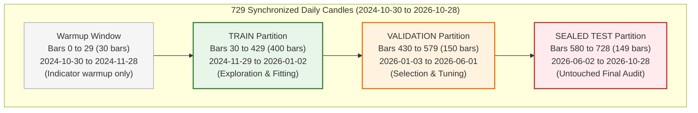
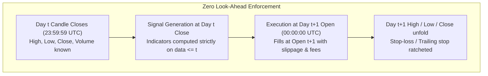

# Data Partition and Sealed Test Protocol

**Date:** 2026-10-30  
**Repository:** `E:\projects\binance`  
**Status:** Architecture Specification  
**Safety & Execution Constraints:** Strictly Offline; All Broker/Exchange Execution Paths Disabled; Strategy V5 Frozen as `VERIFIED NO-GO`; Zero V6 Development; Zero Em Dashes.

---

## 1. Objective and Core Philosophy

In quantitative finance, out-of-sample testing is the only defense against data snooping, selection bias, and overfitting. However, when an automated research agent has unconstrained or repeated access to a test dataset, the test dataset degrades into an in-sample dataset through information leakage and sequential selection bias.

This protocol establishes a strict **Sealed Test Vault** architecture:
1. **TRAIN:** Open access for exploratory data analysis, feature engineering, and hypothesis formulation.
2. **VALIDATION:** Controlled access for hyperparameter selection, sensitivity sweeps, and model ranking.
3. **TEST:** Cryptographically sealed out-of-sample data. The agent is architecturally blocked from inspecting, fitting, or querying the test partition during research.

---

## 2. Partition Architecture and Chronological Boundaries

The primary research dataset consists of 729 synchronized daily candles across BTCUSDT, ETHUSDT, SOLUSDT, and BNBUSDT spanning 2024-10-30 to 2026-10-28.

### 2.1 Partition Definitions and Permissions

| Partition | Bar Index | Dates (UTC) | Return Intervals | Agent Access Policy | Primary Purpose |
| :--- | :--- | :--- | :--- | :--- | :--- |
| **Warmup** | 0 to 29 | 2024-10-30 to 2024-11-28 | N/A | Automated Pre-load | Pre-trade indicator calculation (e.g. 20-day Donchian, 14-day ATR). Zero trades executed. |
| **TRAIN** | 30 to 429 | 2024-11-29 to 2026-01-02 | 400 | Full Unrestricted Access | Hypothesis ideation, feature discovery, baseline fitting. |
| **VALIDATION** | 430 to 579 | 2026-01-03 to 2026-06-01 | 150 | Preregistered Query Only | Hyperparameter selection, block-length sensitivity ($L \in \{5, 10, 20\}$), benchmark hurdle checks. |
| **TEST** | 580 to 728 | 2026-06-02 to 2026-10-28 | 149 | **Sealed Vault Gate** | One-shot final validation. Requires human authorization, frozen code hash, and preregistration lock. |

---

## 3. Sealed Test Vault Mechanism

### 3.1 Architectural Enforcement at the Tool Boundary
The agent does not access raw disk files or unfiltered kline arrays directly. All data access is mediated by `MarketDataProvider`:
1. When an agent queries data for `TRAIN`, the provider returns slice `[0:430]`.
2. When an agent queries data for `VALIDATION`, the provider returns slice `[0:580]`, with execution restricted to bars `430:580`.
3. If an agent attempts to pass `partition="TEST"` to `tool_run_deterministic_backtest` without a valid `TEST_EVALUATION_TOKEN` and formal human approval, the tool bridge immediately raises `SealedPartitionAccessViolation` and records an unauthorized access attempt.

### 3.2 Evaluation Requirements for Opening the Test Partition
To unlock the test partition for an experiment, the following preconditions must be verified by the Research Manager:
1. **Frozen Preregistration:** Hypothesis ID, economic rationale, universe, exact parameter values, and benchmark hurdle rate must be written to `research_ledger.db`.
2. **Validation Success:** The candidate strategy must have passed all validation hurdles:
   - Positive net return after friction ($0.10\%$ fee, $0.05\%$ slippage).
   - Validation paired bootstrap $p < 0.05$ versus cash and BTC benchmarks.
   - Passed dependence screening (Category A or Category B with sensitivity checks).
3. **Adversarial Approval:** Skeptical Researcher must have completed its pre-test audit and identified no fatal data leakage, look-ahead bias, or parameter cliffs.
4. **Code Git Hash Lock:** The exact repository commit hash is recorded to guarantee code immutability.
5. **Human Authorization:** The Human Researcher must provide explicit digital confirmation to generate the single-use `TEST_EVALUATION_TOKEN`.

### 3.3 Protocol for Repeated Test Evaluations and Selection Bias Adjustment
A test partition is only truly "untouched" on its very first evaluation. If multiple configurations from a strategy family or multiple sequential iterations are evaluated on the test partition, selection bias accumulates.

**Mandatory Rules for Repeated Test Evaluations:**
1. **Permanent Ledger Entry:** Every test evaluation is permanently logged in `test_evaluations_ledger` with timestamp, parameters, author, and metrics. Deletion or omission of test runs is strictly prohibited.
2. **Test Trial Counter ($M_{\text{test}}$):** The system maintains an independent test evaluation counter $M_{\text{test}}$ tracking how many times the test partition has been queried across the project lifecycle.
3. **Haircut Sharpe Ratio Adjustment:** For any strategy evaluated after $M_{\text{test}} > 1$, the reported test Sharpe ratio must be accompanied by the Harvey-Liu Haircut Sharpe Ratio:
   $$SR_{\text{haircut}} = SR_{\text{observed}} \times \left(1 - \frac{\sqrt{2 \ln(M_{\text{test}})}}{z_{\alpha} + \sqrt{2 \ln(M_{\text{test}})}}\right)$$
4. **Holm-Bonferroni Family-Wise Adjustment:** If $k$ variations reach the test partition, their test p-values are sorted and adjusted via the Holm-Bonferroni step-down procedure before claiming statistical significance.
5. **Transparency Invariant:** Research dossiers must explicitly declare: "This test partition has been evaluated $M_{\text{test}}$ times. The reported results are Out-of-Sample, but subject to an accumulated multiple-testing penalty."

---

## 4. Look-Ahead and Data Leakage Prevention

Data leakage occurs when future information contaminates historical training data. The data architecture implements the following structural guardrails:

1. **Execution Timing Separation:** Signals are evaluated strictly at Day $t$ Close using prices available at or before $t$. Order execution takes place at Day $t+1$ Open. Same-bar execution (evaluating close and filling at the same close) is prohibited in standard backtesting.
2. **Point-in-Time Indicator Calculations:** All rolling indicators (EMA, SMA, ATR, Donchian channels, Bollinger Bands) must be computed in a strictly expanding or rolling historical window. Global dataset operations (such as z-scoring, min-max normalization, or PCA across the entire 729-day series) are mathematically invalid and blocked by the data loader.
3. **Partition Bleed Prevention:** Warmup windows for validation and test splits must use preceding historical bars strictly for indicator smoothing, with zero state carried over from trading positions or equity balances.

---

## 5. Data Architecture, Provenance, and Limitations

### 5.1 Dataset Provenance and Integrity Verification
Every dataset ingested into the research framework is assigned an immutable manifest:
- **Source:** Binance Public REST API (`/api/v3/klines`).
- **Data Hash:** SHA-256 digest of the raw cached JSON file.
- **Cadence Check:** Verification of strict 86,400,000 ms spacing between consecutive timestamps.
- **Gap Detection:** Automated execution of `detect_gaps` ensuring zero missing candles.
- **Current Data Manifest:**
  - `cached_klines_btcusdt_1d_730d.json` -> 729 bars (SHA-256: `66d0107293b76bb0619a8684eb2ba26ef3f9479b183669dc67852c0022378873`)
  - `cached_klines_ethusdt_1d_730d.json` -> 729 bars (SHA-256: `89f5bc3e284092b7754eb5b1c7cbbd18d41e74f3ff5e0b046e7f86443c5b550d`)
  - `cached_klines_solusdt_1d_730d.json` -> 729 bars (SHA-256: `1e97669d6fb7492c01991ff8d234a2e584fbfcb59fcb0f0b4a4cb3e7e8b69da4`)
  - `cached_klines_bnbusdt_1d_730d.json` -> 729 bars (SHA-256: `13c5e88f4b005e839e94326510344d5cf3dcceba4906f233bebc3b62ffbc7766`)

### 5.2 Critical Limitations of the Current Dataset
The autonomous research agent must explicitly recognize that the current historical data is not sufficient for every quantitative research objective:
1. **Sample Length Limitation ($N=729$):** While 729 daily bars exceeds the $N \ge 500$ operational policy floor established in Direction C.5.6 for the overall series, the test partition in isolation contains only $N=149$ return intervals. Standalone moving-block bootstrap tests on 149 bars suffer from wide confidence intervals and low statistical power. Research hypotheses must evaluate walk-forward concatenated folds or higher-frequency data (4h / 1h) to achieve adequate degrees of freedom.
2. **Regime Representation:** The two-year window (2024 to 2026) captures a specific crypto macro regime (post-halving expansion and subsequent volatility). It does not capture prolonged multi-year crypto winter regimes (such as 2018 or 2022). Strategies showing outperformance on this dataset may possess unmodeled structural beta to crypto market expansions.
3. **Survivorship Bias:** The current 4-asset universe (BTC, ETH, SOL, BNB) consists of major survivors. Testing momentum or rotation across only surviving top-tier tokens overstates performance compared to a true point-in-time universe containing assets that suffered catastrophic 90%+ drawdowns or delistings.
4. **Expansion Roadmap:** Future research directions will ingest historical point-in-time top-20 market cap snapshots and multi-timeframe 1h/4h klines with automated gap detection.

